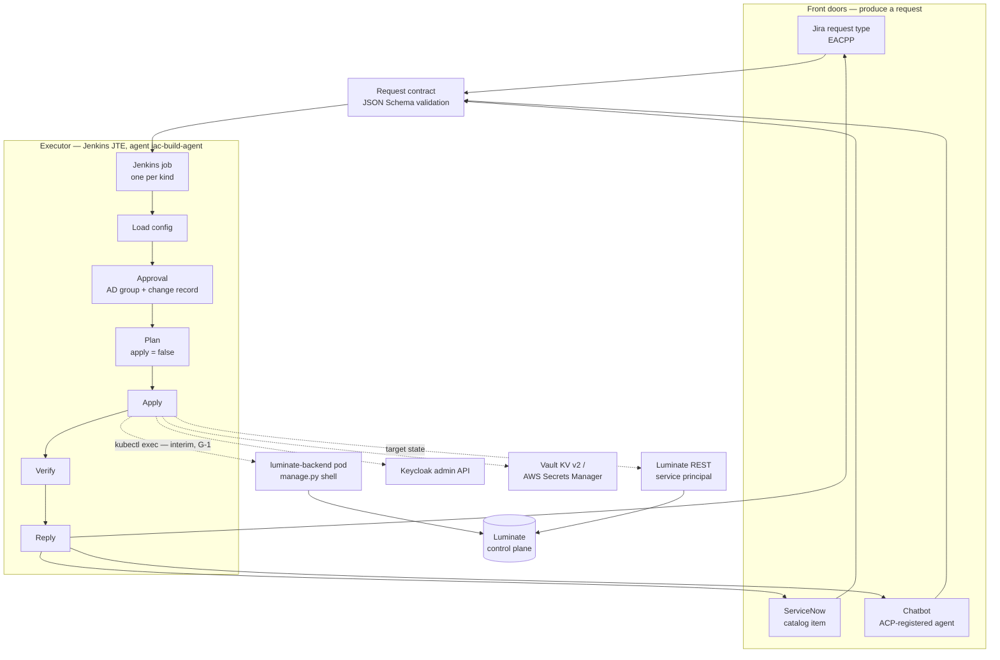
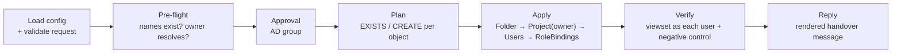
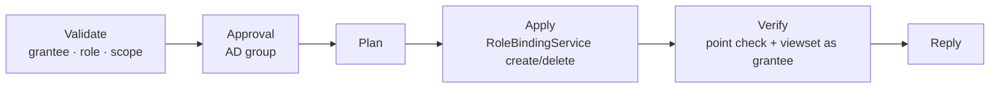
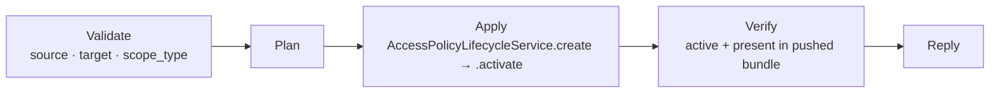
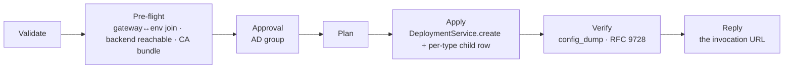
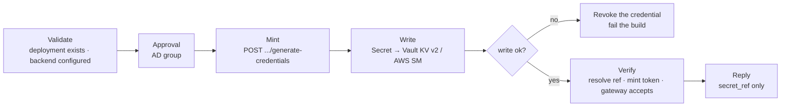
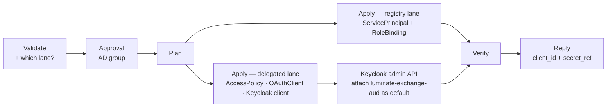
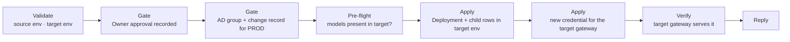
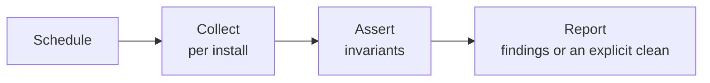
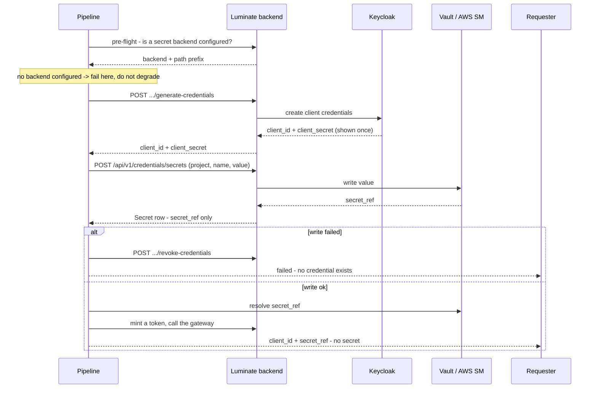

# Self-Service Onboarding — D2: Design

> **Gate**: D2 — Design | **Status**: Draft | **Epic**: [EACPP-1325](https://sunlife.atlassian.net/browse/EACPP-1325)

## 1. Architecture Overview

Three front doors, one contract, one executor, eight pipelines, one reply.



Four properties carry the whole design:

1. **The contract is the only stable interface.** Front doors change, the executor changes,
   the pipelines do not — because none of them talk to each other directly.
2. **The executor is one stage.** `kubectl exec` is where the platform forces us today
   ([G-1](d1-requirements.md#capability-gaps)); replacing it with a REST call must not touch
   anything else.
3. **Plan before apply, always.** The same code path renders the plan and performs it.
4. **Verify or fail.** A pipeline that cannot prove its change did not succeed.

### 1.1 What is new and what is reused

| Layer | Status |
|---|---|
| Jenkins JTE, `iac-build-agent`, Artifactory-pinned `helm`/`kubectl`, per-environment AWS credential, `input` approval gated on an AD group, `refTicket` shape check | **Reused verbatim** from `luminate-sunlife-deploy` `Jenkinsfile_deploy` |
| Provisioning logic — `provision_team.py`, `provision_service_principal.py`, `deploy_mcp_server.py`, `provision_agent.py`, `verify_access.py`, `verify_mcp_route.sh`, `onboarding_message.py` | **Reused** from `acp-product-devkit`, hardened per FR-5 |
| Install registry (`deployments.json`) | **Reused**, extended with secret-backend and Jenkins fields |
| Request contract schema | **New** |
| Front doors and the reply path | **New** |
| Credential-to-secret-store bridge | **New** (G-4) |
| Inventory / drift pipeline | **New** |

## 2. The Pipeline Catalogue

Eight pipelines. Each is a Jenkins job, each takes the same contract, each has the same five
stages. What differs is the plan, the apply and the proof.

| # | Job | `kind` | Trigger | Approval | Applies to | Proof |
|---|---|---|---|---|---|---|
| **P1** | `acp-onboard-tenancy` | `tenancy` | Request | AD group | Control plane | Drive the viewset as each user + negative control |
| **P2** | `acp-grant-access` | `access-grant` | Request | AD group | Control plane | Point check + viewset as the grantee |
| **P3** | `acp-grant-access-policy` | `access-policy` | Request | AD group (non-prod: none) | Control plane | Policy `active` and present in the pushed bundle |
| **P4** | `acp-deploy-resource` | `deployment` | Request | AD group | Control plane + gateway | Endpoint in the gateway `config_dump`; RFC 9728 for delegated MCP |
| **P5** | `acp-issue-credential` | `credential` | Request / schedule | AD group | Control plane + Keycloak + secret store | `secret_ref` resolves; minted token accepted by the gateway |
| **P6** | `acp-provision-machine-identity` | `machine-identity` | Request | AD group | Control plane + Keycloak | Token `aud`/`sub` correct; reads allowed, writes refused |
| **P7** | `acp-promote-resource` | `promotion` | Request | Owner **and** AD group; change record for PROD | Control plane + gateway | Target gateway serves it; models present in the target environment |
| **P8** | `acp-platform-inventory` | `inventory` | Schedule | None | Read-only | It is the proof |

Every job is defined in `Jenkinsfile_<name>` + `pipeline_config_<name>.groovy` in
`acp-product-devkit`, following the `luminate-sunlife-deploy` convention. No job is configured
only in the Jenkins UI (NFR-5).

---

### P1 — `acp-onboard-tenancy`

Stands up a team's tenancy: folder, project, the people who will use it, and their roles.



**Payload**: `folder{name,description}?`, `project{name,description}`, `owner{email,names}`,
`members[]{email,names,roles[]}`, `environments[]`.

**Order is load-bearing.** `Folder` via `FolderService().create()`; `Project` via
`ProjectService().create(owner=...)` — the **only** way an Owner binding comes into existence;
members via `RoleBindingService().create()`, never the ORM ([C-4](d1-requirements.md#constraints),
[C-5](d1-requirements.md#constraints)).

**Pre-flight refusals**, each of which is a permanent mistake if it gets through:

- A project named after a single **resource** rather than the team. A registered resource
  cannot be moved between projects and a deployed one cannot be deleted; the second server the
  team onboards should not need a second project.
- Owner **plus** a per-type Administrator for the same type — Owner is a strict superset, and
  duplicate coverage is the thing access review is supposed to catch.
- A folder or environment name that does not exist in the target install.

**Known consequence to state in the reply, not hide**: Owner does not carry
`iam.user_group.*`. An Owner can create individual role bindings but **cannot add anyone to a
group**. If the ask is "the lead adds their own teammates", the answer is individual bindings;
a group means every future joiner comes back to the ACP Product Team.

---

### P2 — `acp-grant-access`

Adds or removes one role binding. The smallest pipeline, and the most frequently run.



**Payload**: `grantee{type,email|group|principal}`, `role`, `scope{type,name}`, `action`
(`grant` | `revoke`).

**The trap this pipeline exists to avoid**: an org-scope point check returns **deny** even for
the project Owner, because list endpoints filter on `scope_tokens` overlap rather than running
an org point check. Reading that deny as "their catalog will be empty" is wrong. Verification
therefore drives the viewset, and the point check is corroboration only.

---

### P3 — `acp-grant-access-policy`

Grants an agent the right to call a model or an MCP server.



**Payload**: `source{type,id}`, `target{type,id}`, `scope_type`, `actor_email`.

**Never write the policy straight to the ORM.** `AccessPolicyLifecycleService.create()` holds
it at `pending_approval` and records a change event; `.activate()` is the second, audited step.
A raw `status="active"` insert skips both and leaves no governance record.

`scope_type` must match the target type — an MCP server takes
`full_access`/`read_only`/`read_write`/`custom`; a model or agent takes the empty string. A
mismatch trips a database check constraint.

This is the strongest candidate for **no approval inside an already-onboarded project**
([Q-6](d0-discovery.md#open-questions)) — it grants nothing the project does not already hold.

---

### P4 — `acp-deploy-resource`

The mandatory hand-off. Makes a registered resource reachable through a gateway.



**Payload**: `resource{type,key|id}`, `environment`, `gateway`, `endpoint_name`,
`backend_endpoint`, `external_audience?`, `offering?`.

**Three pre-flight checks that each turn a silent failure into a clear one:**

| Check | Silent failure it prevents |
|---|---|
| The gateway has a `GatewayEnvironment` row for the target environment | Empty dropdown, no error, nothing in the logs ([G-7](d1-requirements.md#capability-gaps)) |
| The gateway pod can reach `backend_endpoint`, TLS verified | A route that exists and 500s, or a backend that 401s every call |
| The gateway's merged CA bundle contains the Sun Life issuing CAs | Any `*.sunlifecorp.com` corporate-ingress backend fails `UnknownIssuer`, surfacing as a 500 that names nothing |

**Two refusals**: `stdio` transport cannot be served by a remote gateway; a `backend_endpoint`
without a scheme is rejected.

**The verification that matters.** A `delegated_exchange` target whose audience cannot be
exchanged is **withheld, not downgraded** — the `Deployment` row exists, the API reports
success, and the route simply never appears. Only the gateway's own config dump, and the RFC
9728 `.well-known/oauth-protected-resource/mcp/<endpoint_name>` endpoint, can tell the
difference. A 401 cannot: authentication runs before routing, so a nonexistent endpoint under
a live prefix answers 401 as well.

Model routing needs **four** join rows, not one — `ModelDeployment`, `AgentDeployment`,
an `APIKey` owned by the agent, and an `AccessPolicy`. Missing any of them fails quietly.

---

### P5 — `acp-issue-credential`

Issue, rotate or revoke a workload credential — and put it where it belongs.



**Payload**: `action` (`issue` | `rotate` | `revoke`), `resource{type,id}`, `gateway`,
`secret{backend,name}`, `cutover_at?`.

**This pipeline is the answer to "build an OAuth credential emailer".** The answer is that the
credential should not reach a person at all. `docs/administration/credentials.md` currently
tells the administrator to have the requester *"put it straight into their secret store ... as
you issue it"* — the pipeline does exactly that, without the requester, the transcription or
the channel.

**Preconditions, both hard:**

- A secret backend must be configured for the install. If `CREDENTIAL_BACKENDS` is unset the
  pipeline **fails**; it does not return the value ([G-2](d1-requirements.md#capability-gaps),
  R-3). A degraded mode here becomes the permanent mode.
- The deployment must already exist. Credentials hang off a `(gateway, resource)` pair, not off
  registration.

**Mint-then-write is not atomic** ([G-4](d1-requirements.md#capability-gaps)). The pipeline
makes it look atomic by revoking on write failure — a minted-but-undelivered credential is
worse than no credential, because nothing will ever use it and nothing will ever rotate it.

**Rotation has no overlap window** ([G-5](d1-requirements.md#capability-gaps)). The old secret
stops the moment the new one is issued. The pipeline cannot invent a grace period the platform
does not have, so it does the two things it can: it schedules the cutover at a time the
workload owner agreed, and it announces it in advance. Say so plainly in the reply.

**Do not confuse the two Keycloak clients.** The portal's "add credential" mints a per-`(entity,
gateway)` workload credential named `agent-<entityUUID>-<gatewayUUID>`, which authenticates at
the portal's token endpoint. The entity machine-identity client is `agent-<entityUUID>` and
authenticates at the realm endpoint. They are not interchangeable and the failure mode is an
`invalid_client` that reads like a bad secret.

---

### P6 — `acp-provision-machine-identity`

Gives a workload an identity — either a registry service principal, or the per-agent machine
identity a `delegated_exchange` MCP server needs.



**Payload**: `lane` (`registry` | `delegated-mcp`), plus the lane's own fields —
`{name, external_id, role, scope_type, scope_name}` for the registry lane,
`{agent_id, mcp_server_id, gateway_id?, scope_type?}` for the delegated lane.

**The registry lane is off outside dev.** `SERVICE_PRINCIPAL_AUTH_ENABLED` is `true` in the dev
values file and `false` in test, stage and prod ([G-3](d1-requirements.md#capability-gaps)).
With the flag off, a perfectly valid token returns `401 {"detail":"Authentication credentials
were not provided."}` — byte-identical to sending no header at all. The pipeline must read the
flag in pre-flight and refuse, rather than provisioning something that will silently never
work.

**Step 4 is outside the backend** ([G-6](d1-requirements.md#capability-gaps)). Attaching
`luminate-exchange-aud` as a **default** client scope requires the Keycloak admin API. Skip it
and the call fails 502 with `access_denied: Client is not within the token audience`. The
pipeline needs its own Keycloak admin credential for this one step, and that credential is the
most privileged thing in this design — it is called out in §7.

**Know which `sub` you are keying on.** Keycloak's stock `sub` is the service-account UUID;
Luminate-minted clients carry a mapper that replaces it with the Luminate entity UUID. Decode a
real token rather than assuming.

---

### P7 — `acp-promote-resource`

Moves a resource to the next environment, keeping the separation of duties intact.



**Payload**: `resource{type,id}`, `from_environment`, `to_environment`, `evidence{...}`,
`owner_approval{by,at,reference}`.

**Promotion is one resource with N deployments**, not a copy. The agent is
environment-agnostic; a `Deployment` plus its per-type child row makes it reachable through one
environment's gateway. Uniqueness is `(gateway, deployment_key, agent)`, so the same key is
reused per gateway — that is what makes it one resource rather than four.

**The models must be promoted too**, or the resource lands in an environment with nothing to
call and returns `404 Model not found`, which reads like a broken agent. The pre-flight asserts
it and the pipeline refuses rather than producing that symptom.

**Two approvals, two records.** The project Owner approves the promotion; the platform
administrator performs it. They must be separate recorded events, or the separation of duties
that gates STAGE and PROD exists only in the runbook.

**Each environment's gateway has its own credential** — `OAuthCredential` is scoped
`(gateway, resource)`. Promotion therefore always issues a new credential, which means P7 calls
P5 and inherits its secret-store precondition.

---

### P8 — `acp-platform-inventory`

Scheduled, read-only, and the only pipeline nobody requests.



**Assertions**, each corresponding to a failure that is otherwise silent:

| Assertion | Why |
|---|---|
| Every registered gateway has a `GatewayEnvironment` row for each environment it serves | Missing join → empty dropdown, no error ([G-7](d1-requirements.md#capability-gaps)) |
| Every `Deployment` has a matching route in its gateway's `config_dump` | Withheld delegated routes, and the empty skip list ([G-9](d1-requirements.md#capability-gaps)) |
| Every deployed model resolves to an offering and an account binding | Model routing needs four join rows; three of them fail quietly |
| Every active credential has a resolvable `secret_ref` | Catches a credential that was minted but never delivered |
| No credential is older than the rotation interval | Rotation has no overlap window, so it must be planned, not discovered |
| Every project has a `cost_centre` | Chargeback attributes on it; empty means the usage is unattributable |
| Every published portal and gateway host resolves and answers | DNS landing ahead of a route resolves and then never answers, which reads as a firewall problem |

**A clean run is reported as clean.** Silence is indistinguishable from a broken schedule.

The report also carries the R-4 counter: how many of the period's requests were for things a
team could already have self-served. That number is how First Wave is proved to be ending.

## 3. The Request Contract

One JSON object, schema-validated at the front door.

```json
{
  "version": "1",
  "kind": "tenancy",
  "install": "sunlife-dev",
  "reference": "EACPP-1234",
  "requester": { "email": "tech.lead@sunlife.com", "name": "Tech Lead" },
  "approver":  { "email": "platform.admin@sunlife.com" },
  "actor_email": "platform.admin@sunlife.com",
  "payload": { }
}
```

| Field | Required | Notes |
|---|---|---|
| `version` | yes | Contract version. An unknown version is rejected with a message, never coerced (NFR-8) |
| `kind` | yes | One of the eight in §2. Anything else routes to a human with the request intact |
| `install` | yes | Key into the install registry — `sunlife-dev`, `sunlife-test`, `sunlife-stage`, `sunlife-prod`. **Not** a Luminate `Environment`; see DD-6 |
| `reference` | conditional | Jira key or ServiceNow RITM. Required where the kind requires a change record |
| `requester` | yes | A named human. Never a shared account (CAP-05) |
| `approver` | filled by the executor | Recorded from the `input` submitter, not from the request |
| `actor_email` | yes | The accountable human the platform records in `audit_events` (FR-11) |
| `payload` | yes | Shape determined by `kind`; the per-kind schemas are §2's payload lines |

The existing devkit request files — `request.example.json` for tenancy, MCP deployment and
agent provisioning, `principal.example.json` for service principals — are the starting point
for the payload shapes and are folded into the schema rather than re-invented.

**The `tenancy` payload is the published intake form, made machine-readable.**
`luminate-user-guides` `docs/getting-started/onboarding-intake.md` already asks for the business
area, the contacts, the project and its owner, the parent folder, the cost owner, the people and
their access, and the resources to be registered. Those are the contract's fields. Diverging
from the form would mean maintaining two definitions of the same request, and the form is the
one requesters actually see.

**Every string that will become an identifier carries a shape constraint in the schema** — DNS
label for names and endpoint names, UUID for ids, RFC 5322 for emails, `https?://` for
endpoints. This is the first of the two places FR-5 is enforced; the second is the executor.

## 4. Front Doors

All three produce the contract. None of them talks to the control plane.

| Door | Mechanism | Ships | Strength | Weakness |
|---|---|---|---|---|
| **Jira** | A request issue type in EACPP with fields mapped to the contract; transition to *Approved* triggers the job | First | Reachable today, no new integration, the team already lives there | Not where the rest of Sun Life raises requests |
| **ServiceNow** | A catalog item; the RITM is the record and the approval; an integration account triggers the job | Second ([G-8](d1-requirements.md#capability-gaps)) | The enterprise standard; the change record an auditor expects | Needs an integration account that does not exist yet |
| **Chatbot** | An ACP-registered agent with an MCP server exposing `submit_request`, `check_status`, `list_my_projects` | Third | Meets people where they work; turns a form into a conversation | Circular — if ACP is down, so is the door |

The chatbot is deliberately **not** a shortcut past the other two. It gathers the request,
renders the same contract, and files it through Jira or ServiceNow. It holds no credentials of
its own and performs no administrative act. Its value is that it can ask the four questions a
requester always gets wrong — which environment, which project, which gateway, whose
credential — before a human ever reads the ticket.

Making it an ACP-registered agent, governed by the platform it administers, is dog-fooding with
a real risk attached ([Q-2](d0-discovery.md#open-questions)): the door shares a failure domain
with the thing behind it. The mitigation is that Jira and ServiceNow remain first-class, so the
chatbot is never the only way in.

## 5. Execution Model

### 5.1 The Jenkins shape

Every job is `Jenkinsfile_<name>` plus `pipeline_config_<name>.groovy`, following
`luminate-sunlife-deploy` exactly:

```groovy
pipeline {
    agent { label 'iac-build-agent' }
    parameters {
        string(name: 'request',  description: 'Request contract (JSON).')
        string(name: 'install',  description: 'Target install key.')
        booleanParam(name: 'apply', description: 'Apply. Unchecked = plan only.', defaultValue: false)
        string(name: 'refTicket', description: 'Change record. Required for prod.', defaultValue: '')
    }
    stages {
        stage('Load config')  { /* pipeline_config_<name>.groovy → installCfg */ }
        stage('Validate')     { /* JSON Schema; fail with the offending field */ }
        stage('Pre-flight')   { /* per-kind, read-only */ }
        stage('Approval')     { /* when installCfg.requiresApproval */ }
        stage('Plan')         { /* apply=false path of the same script */ }
        stage('Apply')        { /* when params.apply */ }
        stage('Verify')       { /* mandatory; failure fails the build */ }
        stage('Reply')        { /* always, including on failure */ }
    }
}
```

`pipeline_config_<name>.groovy` returns the same map shape the deploy pipeline uses, extended:

```groovy
return [
    agentLabel   : 'iac-build-agent',
    awsRegion    : 'ca-central-1',
    approvalGroup: 'User_JenkinsProdACPLead_ML',
    installs: [
        'sunlife-dev': [
            eksCluster        : 'slf-eks-t1k-ca-dev',
            namespace         : 'luminate',
            deployCredentialId: 'acp-eks-deploy-aws-dev',
            requiresApproval  : false,
            secretBackend     : '',            // G-2: nothing configured yet
            portalHost        : 'luminate.apps.slf-eks-t1k-ca-dev.aws.sunlifecorp.com',
        ],
        // test / stage / prod …
    ],
]
```

**Inherited, not rebuilt**: the `input(submitter: approvalGroup)` approval; the
`(?i)(CHG|INC)\d{7,}` shape check that stops a Jira key satisfying a change gate; Artifactory-
pinned `helm` and `kubectl` written to `/disk1/bin`; the per-install AWS credential bound with
`AmazonWebServicesCredentialsBinding` and `aws eks update-kubeconfig`.

### 5.2 The executor stage — and the rule that makes it safe

Until [G-1](d1-requirements.md#capability-gaps) closes, Apply runs inside the backend pod. The
pattern is mandatory and is the reason this section exists:

```bash
kubectl --context "$CTX" -n "$NS" exec -i deploy/luminate-backend -c luminate-backend \
  -- env REQUEST="$REQUEST_JSON" APPLY="$APPLY" \
     /opt/.venv/bin/python manage.py shell <<'PY'
import json, os
req = json.loads(os.environ["REQUEST"])
apply = os.environ.get("APPLY") == "1"
...
PY
```

Four rules, all four required:

1. **Quoted heredoc** (`<<'PY'`) — the shell performs no substitution into the script body.
2. **Values through `env`**, read with `os.environ`. Never interpolated into the script, never
   passed as `manage.py shell -c "..."`, never placed in `argv`.
3. **Shape-checked before it is passed** — the schema constrains it (§3) and the executor
   re-checks. Validation at one boundary is a single point of failure.
4. **Fail closed** on anything unrecognised.

*This is not hypothetical.* `provision-gateway.sh` in `luminate-sunlife-deploy` interpolated
`${GW_KEY}` and `${ENV_KEY}` into Python executed by `manage.py shell -c` in the **production**
backend pod. Harmless while a human with `kubectl` ran it; remote code execution the moment
those became build parameters. The same review found four more failures of the same shape —
namespace ownership unchecked, Helm ownership annotations stamped unconditionally, a
`--location`/`--project` typo silently attaching resources to whichever tenant sorted first.
Automating a runbook inherits every one of its unstated assumptions.

**That script has since been hardened and is the reference implementation** — quoted `<<'PYEOF'`
heredoc, every value read through `os.environ`, with the reasoning in a comment above it. The
devkit provisioning scripts have not had the same treatment; T4 gives them it, and until they do
they must not be reachable from a build parameter.

### 5.3 Idempotency and the plan

Plan and Apply are the same code path with a flag, exactly as the devkit scripts already work
(`APPLY=1`). Each object reports one of:

| Verdict | Meaning |
|---|---|
| `EXISTS` | Present and matching; nothing to do |
| `CREATE` | Absent; will be created |
| `CHANGE` | Present and differing; the diff is shown |
| `REFUSE` | Cannot be done, with the reason — e.g. Owner on an existing project |

A second identical run reports only `EXISTS`. A partially failed run is safe to re-run; this is
already proven for the gateway provisioning path, where `provision_for` was shown to converge
rather than rotate.

## 6. Credential Custody



Three properties:

- **The plaintext lives only inside the pipeline process.** It is never logged, never written
  to a build artefact, never placed in a parameter, never included in the reply. A
  secret-scanning stage asserts this (NFR-4).
- **The store is the system of record.** Luminate keeps a `secret_ref`; the value never lands
  in its database. That is CAP-28's design, and it is already implemented upstream — read and
  write, for Vault KV v2, AWS Secrets Manager and GCP Secret Manager.
- **Failure leaves nothing behind.** A credential that was minted but not delivered is revoked
  before the build exits.

The Vault backend authenticates with the pod's Kubernetes service-account JWT, re-read on each
login, and refuses a non-TLS address outside debug. Configuration is `CREDENTIAL_BACKENDS`,
`VAULT_ADDR`, `VAULT_MOUNT`, `VAULT_K8S_ROLE`, `VAULT_K8S_AUTH_PATH`, `VAULT_K8S_TOKEN_PATH`
and `VAULT_NAMESPACE` — **none of which is set in any Sun Life values file today**
([G-2](d1-requirements.md#capability-gaps)). Wiring them belongs to `sunlife-deployment` and is
the single hard dependency of P5.

Where the Vault path for a tenant's credential should live is
[Q-3](d0-discovery.md#open-questions): under the ACP namespace path, where we can rotate it,
or under the tenant's own, where they can. It decides who is on the hook at 2 a.m.

## 7. Security Considerations

| Concern | Control |
|---|---|
| Command injection through a build parameter | §5.2, all four rules. The historical precedent is named so nobody relaxes it |
| Privilege escalation via the pipeline | The pipeline holds exactly the authority of the administrator it replaces. Approval groups gate who may run it; the plan is reviewed before apply |
| Secret exposure | §6. Reference-only replies; secret scanning; revoke-on-failure |
| **The Keycloak admin credential** | P6 needs realm-admin rights to attach a default client scope ([G-6](d1-requirements.md#capability-gaps)). It is the most privileged credential in this design. It is bound to P6 alone, never to the shared folder, and its use is limited to `PUT .../default-client-scopes/{id}`. Closing G-6 removes it entirely |
| Attribution | `actor_email` carries the accountable human into `audit_events` (FR-11). The pipeline's own identity is never the actor of record |
| Separation of duties | P7 records the Owner's approval and the administrator's action as separate events. The requester cannot be the approver |
| Blast radius of a bad request | Plan-before-apply; schema validation at the door; shape checks at the executor; `REFUSE` verdicts for permanent mistakes |
| Kill switch independence | NFR-3. CAP-11 must remain reachable without any pipeline. An emergency stop that needs a green build is not an emergency stop |
| Least privilege on the cluster credential | Per-install `acp-eks-deploy-aws-<env>`, namespaced RBAC in `luminate` only — the same principal and grant the deploy pipeline already uses |

## 8. Design Decisions

### DD-1 — One request contract, many front doors

Front doors produce requests; one executor consumes them. A door never calls the control plane.

*Considered and rejected*: letting each door integrate directly, which is faster for the first
door and unmaintainable by the third. The contract is the thing that must stay stable; the
doors are allowed to churn.

### DD-2 — Jenkins JTE is the executor

Approval gated on an AD group, change-record shape checking, per-environment credential
binding, build history as an audit trail, and a review path for the pipeline definition all
already exist in `luminate-sunlife-deploy` and are Sun Life standard (INT-08).

*Considered and rejected*: a bespoke service. It would need to rebuild every one of those, and
would introduce a long-lived credential-holding service where a build agent suffices.

### DD-3 — `kubectl exec` is the interim executor, and it is one stage

Forced by [G-1](d1-requirements.md#capability-gaps): no machine credential is accepted on the
administrative REST surfaces. Confined to a single shared step (FR-12) so that closing G-1 is a
stage swap.

*Considered and rejected*: driving the portal UI with a browser automation. It has the same
authentication problem, is brittle against every release, and produces worse evidence.

### DD-4 — A credential is delivered by reference, never by value

The request that opened this spec was for an "OAuth credential emailer". Emailing it is the
wrong fix. The platform already supports writing the value into Vault or AWS Secrets Manager
and keeping only a reference; the pipeline does that, and the reply carries the reference.

*Considered and rejected*: a one-time secret link. It is better than email and still puts the
plaintext in front of a person and a browser, and it does nothing for rotation.

### DD-5 — Approval stays human; execution does not

These pipelines automate the twelve database writes, not the decision. Access grants, credential
issuance and promotion all keep a named approver.

*Considered and rejected*: auto-approving low-risk kinds. P3 inside an already-onboarded
project is the one genuine candidate and is left as [Q-6](d0-discovery.md#open-questions)
rather than assumed.

### DD-6 — `install` and `environment` are different axes, and both are named

An **install** is a whole cluster, database and catalogue — `sunlife-dev`, `sunlife-test`,
`sunlife-stage`, `sunlife-prod`; it is ACP's own SDLC. An **environment** is a row inside one
install's catalogue — dev, sit, stage, prod; it is the tenant's SDLC. The same four words name
both, which is why the contract carries `install` and the payload carries `environment`.

*This is not pedantry.* A request saying "deploy to prod" is ambiguous in a way that puts a
tenant's pilot into the production install, and the production install has never held a tenant.

### DD-7 — Verification is a stage and it drives the real surface

A pipeline that cannot prove its change did not succeed. Row counts prove rows. The
proof is the viewset, the gateway's config dump, the RFC 9728 endpoint, or a resolved secret
reference.

*Considered and rejected*: verifying afterwards in P8. Drift detection is a different job from
change confirmation, and a failure found next Tuesday is a failure the requester found first.

### DD-8 — The chatbot is a front door, not a second executor

It gathers and files. It holds no credentials and performs no administrative act.

*Considered and rejected*: letting it act directly, which makes a conversational interface a
privileged one and puts a language model on the write path of a production control plane.

### DD-9 — No fallback when the secret store is unavailable

P5 fails rather than returning the value. Stated as a decision because the pressure to add a
fallback will be real and immediate, and a temporary degraded mode is how the current situation
came to exist.

### DD-10 — The pipelines execute today's authorisation model; they do not widen it

Delegating deployment to project Owners is EACPP-1109 and depends on upstream portal RBAC.
Automating first and delegating second is the right order: once every administrative act runs
through one contract with one audit trail, opening a step up is a policy change.

### DD-11 — Addresses come from a registry and are re-probed before publication

Hostnames are not patterned and there is no wildcard DNS. The dev install's
`luminate.`/`gateway.` prefix pair invites a rule that is wrong in production, where the four
environments are `gw-dev`, `gw-sit`, `gw-stage` — and PROD is plain `gateway`. `gw-prod` does
not exist.

### DD-12 — One Jenkins folder, per-install credentials

Matches the deploy pipeline and keeps promotion — which crosses installs only in the sense that
it crosses environments inside one — expressible. Revisit if an install ever needs a different
approval group ([Q-5](d0-discovery.md#open-questions)).

## 9. Observability

| Signal | Where | Why |
|---|---|---|
| Request received, validated, rejected | Front door + build log | SC-3; a rejected request must still be a record |
| Plan output | Build artefact, retained | The approver approved *something*; that something is evidence |
| Apply verdicts per object | Build log + reply | Idempotency is only useful if it is visible |
| `audit_events` rows attributed to `actor_email` | Luminate | SC-1; this is the count that shows the manual path shrinking |
| Verification result | Build status | SC-4; a pipeline cannot be green with a failed verification |
| Secret writes | The store's own audit log | SC-2; the store, not the pipeline, is the system of record |
| Inventory findings, including an explicit clean | P8 report | SC-5 |
| Requests that could already have been self-served | P8 report | R-4; the number that shows First Wave ending |

## 10. Rollout

| Phase | What ships | Exit condition |
|---|---|---|
| **0 — Preconditions** | Contract schema; install registry extended; devkit scripts hardened per FR-5; Jenkins folder, credentials and approval groups | A hardened script runs unchanged under a build parameter containing shell metacharacters |
| **1 — Prove the shape** | P1 (tenancy) and P8 (inventory) against `sunlife-dev`, Jira front door | One real team onboarded end to end with no manual step, and P8 reporting on all four installs |
| **2 — The bottleneck** | P4 (deployment), P3 (access-policy), P2 (access-grant) | The mandatory hand-off is a pipeline |
| **3 — Credentials** | P5, gated on [G-2](d1-requirements.md#capability-gaps) being closed | A credential delivered to a secret store and resolved by a workload that was never told it |
| **4 — The rest** | P6 (machine identity), P7 (promotion) | A promotion to STAGE with both approvals recorded separately |
| **5 — Doors** | ServiceNow catalog item; chatbot | ≥ 90% of requests arrive through a front door |

Rollback at every phase is the runbook that exists today — the devkit skills stay current and
executable, because a pipeline that cannot be performed by hand is a pipeline nobody can debug.

## 11. Requirement Traceability

| Requirement | Design section | Pipeline |
|---|---|---|
| FR-1 | §3 | all |
| FR-2 | §2 | P1–P8 |
| FR-3 | §5.3 | all |
| FR-4 | §2 (per-pipeline proof), DD-7 | all |
| FR-5 | §3, §5.2 | all |
| FR-6 | §6, DD-4, DD-9 | P5 |
| FR-7 | §5.1, DD-5 | P1, P2, P5, P7 |
| FR-8 | §5.3 | all |
| FR-9 | §5.1 Reply stage | all |
| FR-10 | DD-11 | P1, P4, P7 |
| FR-11 | §3, §7 | all |
| FR-12 | §5.2, DD-3 | all |
| NFR-3 | §7 | — |
| NFR-4 | §6, §7 | P5, P6 |
| NFR-5 | §2, §5.1 | all |
| NFR-8 | §3 | all |
