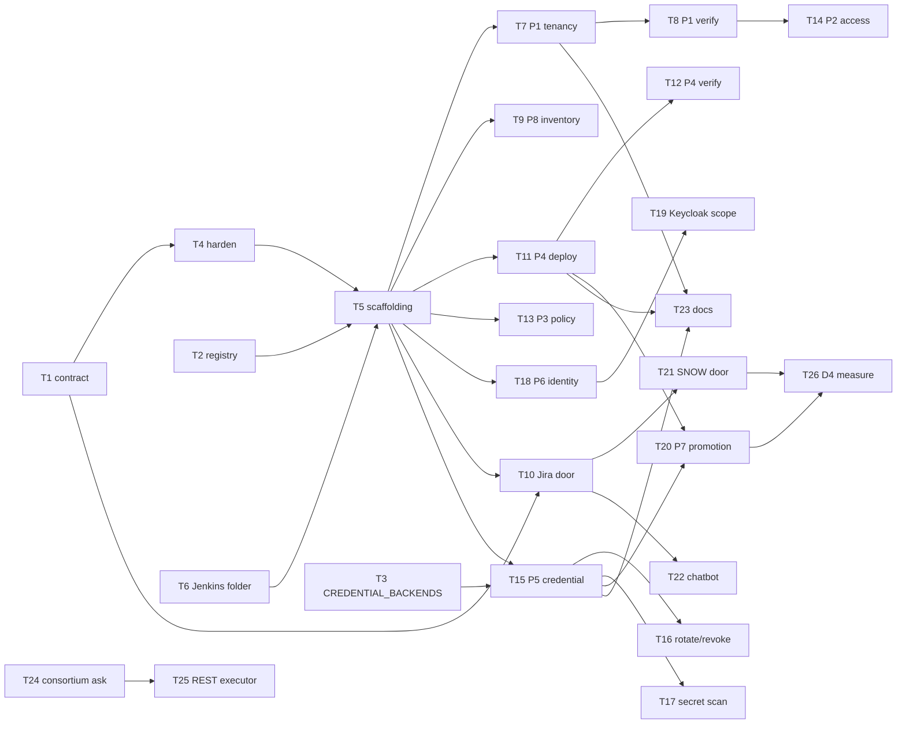

# Self-Service Onboarding — D3: Implementation Plan

> **Gate**: D3 — Tasks | **Status**: Draft | **Epic**: [EACPP-1325](https://sunlife.atlassian.net/browse/EACPP-1325)

## How to read this

The D2 design is the target state. This plan is the **delta** — what has to be built, in what
order, and which of it is blocked on something outside the ACP Product Team's control.

Two tasks are not ours to complete. **T3** waits on a Sun Life deployment change
(`CREDENTIAL_BACKENDS`), and **T24** is a consortium ask. Everything else is buildable today.

## Task Summary

| Task | Description | Type | Points | Sprint | Depends On |
|---|---|---|---|---|---|
| **T1** | Write the request contract JSON Schema. One `version`/`kind`/`install`/`requester`/`actor_email`/`payload` envelope, with the `tenancy` payload taking its fields from the published intake form (`luminate-user-guides` `docs/getting-started/onboarding-intake.md`) and the rest folded in from the devkit's `request.example.json` and `principal.example.json`. Every identifier field carries a shape constraint — DNS label for names and endpoint names, UUID for ids, RFC 5322 for emails, `https?://` for endpoints. Publish it in `acp-product-devkit` as the single normative definition. | Story | 3 | S1 | — |
| **T2** | Extend the install registry with the fields the executor needs. `deployments.json` gains kube context, namespace, Jenkins credential id, approval group, `requiresApproval`, secret backend and path prefix, plus the verified portal and gateway hosts per environment. Keep `--verify` re-probing before any address is published. | Story | 2 | S1 | — |
| **T3** | Wire `CREDENTIAL_BACKENDS` and provision the Vault path for the `luminate` namespace. Needs the KV mount and Kubernetes auth role as well. Closes G-2, and **blocks T15 entirely** — until a write succeeds end to end, the credential pipeline cannot ship without degrading into handing out plaintext. Belongs with `sunlife-deployment` (EACPP-596). | Story | 5 | S1 | — |
| **T4** | Harden the devkit provisioning scripts to the FR-5 execution pattern. Quoted heredoc, values through `env` read with `os.environ`, shape regex on every identifier, fail closed. `luminate-sunlife-deploy` `scripts/provision-gateway.sh` is the reference implementation — it has already had this treatment. Add a regression test that runs each script with a parameter containing shell metacharacters and asserts it is refused rather than executed. | Story | 5 | S1 | T1 |
| **T5** | Build the shared Jenkins scaffolding every pipeline inherits. `Jenkinsfile_<name>` + `pipeline_config_<name>.groovy` conventions, the Load config / Validate / Pre-flight / Approval / Plan / Apply / Verify / Reply stage skeleton, Artifactory-pinned `kubectl`, per-install AWS credential binding, and the one swappable executor step. | Story | 5 | S1 | T2, T4 |
| **T6** | Provision the Jenkins folder, per-install AWS credentials and approval AD groups for the new jobs. Confirm the folder ACL distinguishes who may trigger from who may approve, as the existing prod deploy folder does. | Task | 2 | S1 | — |
| **T7** | Build **P1 `acp-onboard-tenancy`**. Folder, project with owner, just-in-time user rows with a verified primary `EmailAddress`, role bindings through the service layer. Pre-flight refuses a resource-named project, duplicate Owner plus per-type Administrator coverage, and unknown folder or environment names. | Story | 5 | S2 | T5 |
| **T8** | Build P1's verification stage. Drive `ProjectViewSet.as_view({"get": "list"})` as each granted user **and** as a negative control with no binding on the project. Fail the build on anything less. Do not accept an organization-scope point check as evidence — it denies even for the project Owner. | Story | 3 | S2 | T7 |
| **T9** | Build **P8 `acp-platform-inventory`**. Scheduled and read-only, asserting gateway-to-environment joins, deployment-to-route correspondence, model join rows, resolvable credential references, credential age, project cost centres, and host reachability. Report an explicit clean run. | Story | 5 | S2 | T5 |
| **T10** | Build the Jira front door: a request issue type in EACPP whose fields map to the contract, validation on submit with the offending field named, transition-to-approved triggering the job, and the reply written back as a comment. | Story | 5 | S2 | T1, T5 |
| **T11** | Build **P4 `acp-deploy-resource`** and its three pre-flight checks. The checks are the gateway-to-environment join, backend reachability with TLS verified, and the Sun Life CA bundle present in the gateway. It refuses `stdio` transport and a scheme-less backend endpoint. | Story | 5 | S3 | T5 |
| **T12** | Build P4's verification against the gateway's own view of itself. Assert the endpoint name appears in `config_dump`, and for a `delegated_exchange` MCP endpoint that RFC 9728 `.well-known/oauth-protected-resource/mcp/<name>` returns 200. A 401 is not evidence — authentication runs before routing, so a nonexistent endpoint answers 401 too. | Story | 3 | S3 | T11 |
| **T13** | Build **P3 `acp-grant-access-policy`** using `AccessPolicyLifecycleService.create()` then `.activate()`, never a direct ORM write, with `scope_type` validated against the target type so the check constraint cannot be tripped. | Story | 3 | S3 | T5 |
| **T14** | Build **P2 `acp-grant-access`** for grant and revoke of a single role binding, verified by driving the viewset as the grantee rather than by a point check. | Story | 3 | S3 | T8 |
| **T15** | Build **P5 `acp-issue-credential`**. Mint through `generate-credentials`, write through the secret writer, revoke on write failure, and reply with a reference only. Fail the build when no secret backend is configured for the install rather than returning the value. | Story | 5 | S4 | T3, T5 |
| **T16** | Build P5's rotate and revoke paths, including the scheduled cutover and the advance announcement. State plainly in the reply that there is no overlap window and the old secret stops on issue. | Story | 3 | S4 | T15 |
| **T17** | Add a secret-scanning stage asserting no plaintext credential reaches a log, artefact, build parameter or reply. Run it on every pipeline, not only P5. | Story | 2 | S4 | T15 |
| **T18** | Build **P6 `acp-provision-machine-identity`**, both lanes. Pre-flight must read `SERVICE_PRINCIPAL_AUTH_ENABLED` for the install and refuse the registry lane where it is off, rather than provisioning an identity whose valid token will return a 401 indistinguishable from sending no header. | Story | 5 | S4 | T5 |
| **T19** | Wire P6's Keycloak admin step: attach `luminate-exchange-aud` as a default client scope. Bind the realm-admin credential to this job alone, scope its use to the single `PUT`, and document that closing G-6 removes it. | Story | 3 | S4 | T18 |
| **T20** | Build **P7 `acp-promote-resource`**. Record the project Owner's approval and the platform administrator's action as separate events, pre-flight that the resource's models are already present in the target environment, and issue a new credential for the target gateway through P5. | Story | 5 | S5 | T15, T11 |
| **T21** | Build the ServiceNow front door: catalog item, field mapping to the contract, integration account, and the RITM as the approval record. Closes G-8. | Story | 5 | S5 | T1, T10 |
| **T22** | Build the chatbot front door as an ACP-registered agent with an MCP server exposing `submit_request`, `check_status` and `list_my_projects`. It files through Jira or ServiceNow and holds no credentials of its own. | Story | 5 | S6 | T10 |
| **T23** | Update `luminate-user-guides` to point at the front door instead of two named individuals, and update `acp-product-devkit` so each skill states which pipeline now owns it and remains executable by hand as the rollback path. | Story | 3 | S6 | T7, T11, T15 |
| **T24** | Raise the consortium ask for G-1. Accept a service principal on the `organization`, `iam`, `deployment`, `credentials` and `resource-access` surfaces, authorised by the principal's own role bindings. Carry the narrow form — this is not a request to widen what a principal may do, only to let one authenticate at all. | Spike | 3 | S6 | — |
| **T25** | Swap the executor stage from `kubectl exec` to REST once T24 lands, and prove the request contract, approval model, verification stages and front doors are untouched by the change. | Story | 5 | S7 | T24 |
| **T26** | Close out D4: measure SC-1 through SC-7 over a full month and record the result, including the R-4 counter of requests that could already have been self-served. | Task | 3 | S7 | T20, T21 |

## Luminate Support Checks

> Capability verdicts are snapshots. Re-verify against `origin/main` — not the capability map,
> not a feature branch — before starting any task in this table.

| Task | Luminate support | What to re-verify at pick-up |
|------|------------------|------------------------------|
| T3 | CAP-28 · G-2 | That `backend/app/credentials/secret_backends/vault.py` and `writer.py` still exist and `VaultKvWriter` is still registered in `CredentialWriter`. An earlier ACP note recorded Vault as unimplemented and was stale within weeks; assume the same of this one. |
| T4 | — | That the devkit scripts have not gained a new `manage.py shell -c` call site since hardening. |
| T11, T12 | CAP-04 · G-9 | That a `delegated_exchange` deployment whose audience cannot be exchanged is still **withheld rather than downgraded**, and that `build_bundle()` still returns an empty skip list while emitting nothing. If either changed, the verification can be simplified. |
| T13 | CAP-07 | That `AccessPolicyTargetType` and the `scope_type` check constraint are unchanged, and that `AccessPolicyLifecycleService` still holds a new policy at `pending_approval`. |
| T15, T16 | CAP-28 · G-4 · G-5 | Whether minting and writing have been joined into one operation, and whether dual-active secrets with a grace period have landed. Either would remove work from these tasks. |
| T18, T19 | CAP-06 · G-3 · G-6 | Whether `SERVICE_PRINCIPAL_AUTH_ENABLED` is still off outside dev, and whether the backend can now attach a default client scope itself. T19 disappears entirely if it can. |
| T20 | CAP-14 | Whether governance findings actually gate STAGE — `ApplicabilityRule` has been empty in at least one install, which makes the gate vacuous while looking enforced. |
| T24, T25 | CAP-06 · G-1 | That `DEFAULT_AUTHENTICATION_CLASSES` still excludes a machine authenticator and `RegistryBearerAuthMixin` is still on the three catalog viewsets only. This is the premise of both tasks. |

## Dependency Graph

**Critical chain**: T3 → T15 → T20 → T26. T3 is the only one of those the ACP Product Team
cannot start and finish itself, which makes it the first thing to raise, not the first thing to
schedule.

## Sprint Allocation

### Sprint 1 — Preconditions

| Task | Points | Definition of Done |
|---|---|---|
| T1 contract schema | 3 | A malformed request of every kind is rejected with the offending field named |
| T2 install registry | 2 | `--verify` re-probes every published host and exits non-zero on a dead one |
| T3 `CREDENTIAL_BACKENDS` | 5 | A secret written from the backend pod and read back through its `secret_ref` |
| T4 harden scripts | 5 | Each script refuses a parameter containing shell metacharacters, proven by test |
| T5 Jenkins scaffolding | 5 | A no-op job runs all eight stages against `sunlife-dev` |
| T6 folder and credentials | 2 | A member can trigger and cannot self-approve |

### Sprint 2 — Prove the shape

| Task | Points | Definition of Done |
|---|---|---|
| T7 P1 tenancy | 5 | A real team onboarded on `sunlife-dev` with no manual step |
| T8 P1 verification | 3 | Build fails when the negative control can see the project |
| T9 P8 inventory | 5 | Runs against all four installs; a seeded unmapped gateway is reported |
| T10 Jira front door | 5 | A request raised in Jira triggers the job and receives its reply as a comment |

### Sprint 3 — The bottleneck

| Task | Points | Definition of Done |
|---|---|---|
| T11 P4 deployment | 5 | Pre-flight refuses an unreachable backend before anything is written |
| T12 P4 verification | 3 | A deliberately withheld delegated route fails the build |
| T13 P3 access policy | 3 | Policy reaches `active` and appears in the pushed bundle |
| T14 P2 access grant | 3 | Grant and revoke both verified by driving the viewset |

### Sprint 4 — Credentials and identity

| Task | Points | Definition of Done |
|---|---|---|
| T15 P5 issue | 5 | Credential resolved from the store by a workload that was never told the secret |
| T16 rotate and revoke | 3 | Scheduled cutover announced in advance and executed at the agreed time |
| T17 secret scanning | 2 | A deliberately leaked value fails the build |
| T18 P6 machine identity | 5 | Registry lane refuses where `SERVICE_PRINCIPAL_AUTH_ENABLED` is off |
| T19 Keycloak scope | 3 | Token carries the exchange audience; realm-admin credential bound to this job alone |

### Sprint 5 — Promotion and the enterprise door

| Task | Points | Definition of Done |
|---|---|---|
| T20 P7 promotion | 5 | A STAGE promotion with Owner approval and administrator action recorded separately |
| T21 ServiceNow door | 5 | A RITM triggers the job and carries the approval record |

### Sprint 6 — Doors, documentation and the ask

| Task | Points | Definition of Done |
|---|---|---|
| T22 chatbot | 5 | Gathers a request, files it, holds no credentials |
| T23 documentation | 3 | The user guides name a front door, not two individuals |
| T24 consortium ask | 3 | Raised with the narrow form recorded |

### Sprint 7 — Target executor and measurement

| Task | Points | Definition of Done |
|---|---|---|
| T25 REST executor | 5 | Executor swapped with no change to contract, approval, verification or doors |
| T26 D4 measurement | 3 | SC-1 to SC-7 measured over a month and recorded |

## Risk Mitigation

| Risk (from D0) | Mitigation Task | Sprint |
|---|---|---|
| R-1 command injection | T4, and the FR-5 pattern baked into T5 | S1 |
| R-3 plaintext fallback becomes permanent | T3 gates T15; T15 fails rather than degrading | S1, S4 |
| R-4 automation entrenches First Wave | T9 reports the self-servable count; T26 measures it | S2, S7 |
| R-5 `kubectl exec` becomes permanent | T24 raises the ask, T25 performs the swap, T5 makes it one stage | S1, S6, S7 |
| R-6 verification passes while nothing happened | T8, T12 — both drive the real surface | S2, S3 |
| R-7 front-door sprawl | T1 is a hard dependency of all three doors | S1 |
| R-8 rotation breaks a workload | T16 schedules and announces; G-5 escalated | S4 |

## Jira Ticket Map

> Created 2026-09-16 under epic [EACPP-1325](https://sunlife.atlassian.net/browse/EACPP-1325).

| Task | Jira Key | Status |
|---|---|---|
| T1 | [EACPP-1326](https://sunlife.atlassian.net/browse/EACPP-1326) | To Do |
| T2 | [EACPP-1327](https://sunlife.atlassian.net/browse/EACPP-1327) | To Do |
| T3 | [EACPP-1328](https://sunlife.atlassian.net/browse/EACPP-1328) | To Do |
| T4 | [EACPP-1329](https://sunlife.atlassian.net/browse/EACPP-1329) | To Do |
| T5 | [EACPP-1330](https://sunlife.atlassian.net/browse/EACPP-1330) | To Do |
| T6 | [EACPP-1331](https://sunlife.atlassian.net/browse/EACPP-1331) | To Do |
| T7 | [EACPP-1332](https://sunlife.atlassian.net/browse/EACPP-1332) | To Do |
| T8 | [EACPP-1333](https://sunlife.atlassian.net/browse/EACPP-1333) | To Do |
| T9 | [EACPP-1334](https://sunlife.atlassian.net/browse/EACPP-1334) | To Do |
| T10 | [EACPP-1335](https://sunlife.atlassian.net/browse/EACPP-1335) | To Do |
| T11 | [EACPP-1336](https://sunlife.atlassian.net/browse/EACPP-1336) | To Do |
| T12 | [EACPP-1337](https://sunlife.atlassian.net/browse/EACPP-1337) | To Do |
| T13 | [EACPP-1338](https://sunlife.atlassian.net/browse/EACPP-1338) | To Do |
| T14 | [EACPP-1339](https://sunlife.atlassian.net/browse/EACPP-1339) | To Do |
| T15 | [EACPP-1340](https://sunlife.atlassian.net/browse/EACPP-1340) | To Do |
| T16 | [EACPP-1341](https://sunlife.atlassian.net/browse/EACPP-1341) | To Do |
| T17 | [EACPP-1342](https://sunlife.atlassian.net/browse/EACPP-1342) | To Do |
| T18 | [EACPP-1343](https://sunlife.atlassian.net/browse/EACPP-1343) | To Do |
| T19 | [EACPP-1344](https://sunlife.atlassian.net/browse/EACPP-1344) | To Do |
| T20 | [EACPP-1345](https://sunlife.atlassian.net/browse/EACPP-1345) | To Do |
| T21 | [EACPP-1346](https://sunlife.atlassian.net/browse/EACPP-1346) | To Do |
| T22 | [EACPP-1347](https://sunlife.atlassian.net/browse/EACPP-1347) | To Do |
| T23 | [EACPP-1348](https://sunlife.atlassian.net/browse/EACPP-1348) | To Do |
| T24 | [EACPP-1349](https://sunlife.atlassian.net/browse/EACPP-1349) | To Do |
| T25 | [EACPP-1350](https://sunlife.atlassian.net/browse/EACPP-1350) | To Do |
| T26 | [EACPP-1351](https://sunlife.atlassian.net/browse/EACPP-1351) | To Do |

## Notes

- **The devkit skills stay current and executable.** A pipeline that cannot be performed by
  hand is a pipeline nobody can debug, and the skills are the rollback path at every phase.
- **T3 is not ACP Product Team work but it is on our critical chain.** Raise it first, schedule
  around it second.
- **T24 is an ask, not a commitment.** An EACPP ticket records a Sun Life position; it is not
  evidence the consortium agreed.
- **Do not renumber these tasks after the Jira tickets exist.** Ticket identity is keyed on the
  `T<n>:` summary prefix, so a renumber both creates duplicates and overwrites the tickets whose
  numbers were reused.
