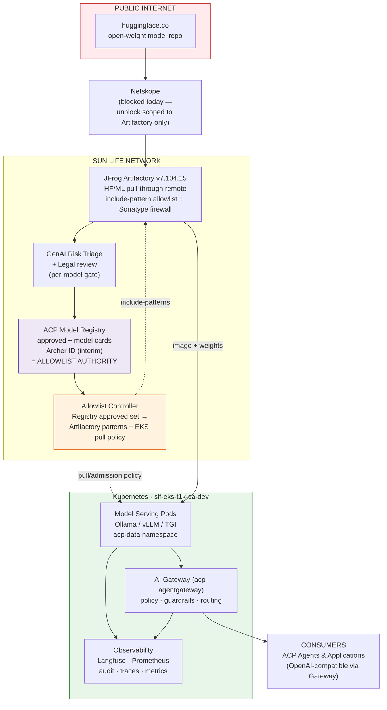
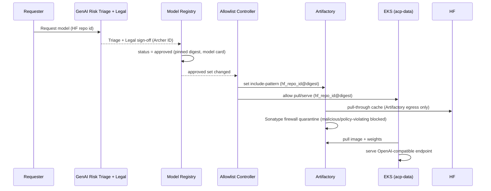
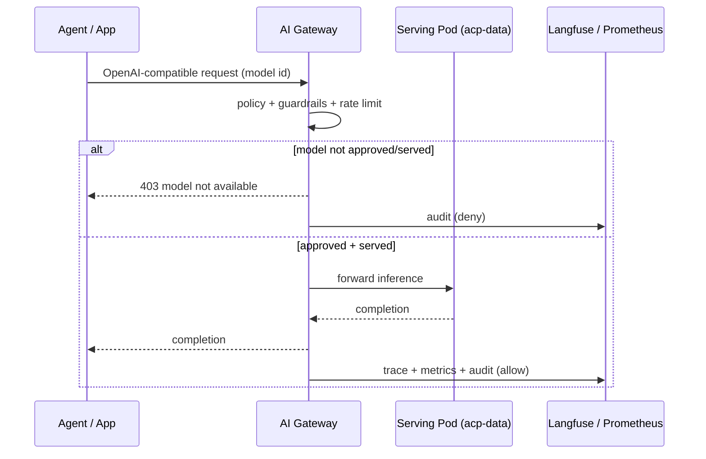
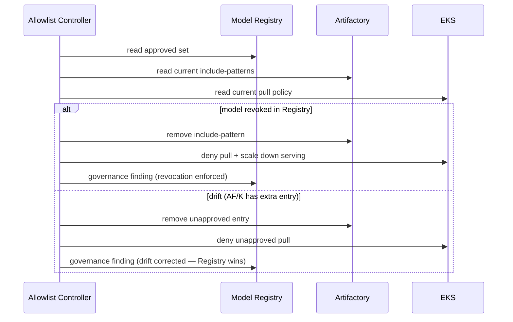
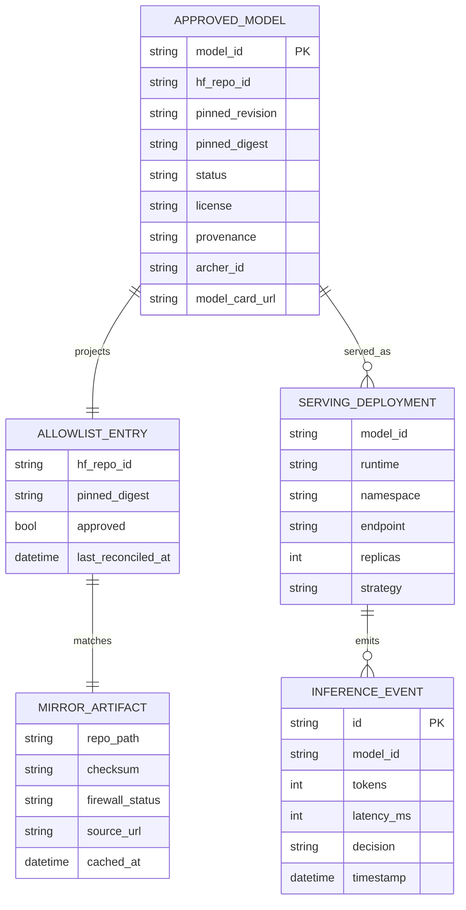

# Small Local Model (SLM) Pipeline — D2: Design

> **Gate**: D2 — Design | **Status**: Draft | **Epic**: EACPP-557

## Architecture Overview

The pipeline is a **single governed chokepoint**: Hugging Face → Artifactory (mirror + scan) →
ACP Model Registry (approval + allowlist authority) → EKS serving (`acp-data`) → AI Gateway →
consumers. Egress to `huggingface.co` is allowed **only** from Artifactory; EKS pulls everything
from Artifactory and never touches the internet. The Model Registry's approved set is the single
source of truth that constrains what Artifactory caches and what EKS may pull and serve.

## Key Design Decisions

| # | Decision | Choice | Alternatives Considered | Rationale |
|---|----------|--------|------------------------|-----------|
| 1 | Egress chokepoint | Artifactory pull-through is the only HF path | Per-pod HF access; developer downloads | Single vetted, scanned source; EKS stays air-gapped from HF (NFR-1) |
| 2 | Netskope scope | Allow `huggingface.co` from Artifactory hosts only | Broad estate unblock | Minimizes blast radius; the primary ISRA ask |
| 3 | Allowlist authority | ACP Model Registry approved set = source of truth | Artifactory-managed list; static config | One governed authority; serving ⊆ approved (NFR-3); no parallel list to drift |
| 4 | Allowlist projection | Controller reconciles Registry → Artifactory include-patterns + EKS pull policy | Manual repo config; admission-only | Convergent, auditable, fail-closed; covers both mirror and serve |
| 5 | Unknown model behavior | Fail-closed (deny pull + serve) | Fail-open | Regulatory posture; no un-approved model reachable |
| 6 | Artifact pinning | Pin by revision + content digest; checksum verified | Floating `latest`/tag | Reproducible, immutable mirrors (NFR-5) |
| 7 | Weight format | Prefer safetensors; reject/sandbox pickle | Allow pickle | Avoids arbitrary code execution at load (NFR-6) |
| 8 | Serving runtime (POC) | **Batched `transformers` server now; vLLM/TGI for production** | Ollama; unbatched `transformers`; vLLM-only | **Revised 2026-08-25.** Ollama in the internal ECR is 0.6.8 — too old for the PoC model. An *unbatched* `transformers` server was measured at 14.8 tok/s and $21.42/1M; adding fused attention + request batching reached 444.74 tok/s and $0.71/1M on the same A10G, and 481.93 tok/s at $0.53/1M on L4. Batching is the viability line, not an optimisation |
| 9 | Pod update strategy | `Recreate` for single-replica model pods | RollingUpdate | CPU-tight dev nodes can't schedule a 2nd Pending pod (NFR-8) |
| 10 | Approval artifacts | Archer ID on Registry entry (interim) | New GRC store | Reuse existing GRC artifact home; revisit at maturity |
| 11 | Phasing | Phase 0 POC under in-flight ISRA; Phase 1 separate ISRA + ATG | One big-bang submission | De-risk via dev POC; broad pipeline gets its own risk + architecture review |
| 12 | Accelerator | **GPU required for interactive serving; bf16-capable only; allow both `g5` and `g6`** | CPU-only; quantized CPU; pinning one instance family | CPU measured 1.5 tok/s and ~11 min for a 1,508-token prompt; GPU reduces the same prompt to 1.2 s. **L4 (`g6`) preferred over A10G (`g5`)** — measured faster at every reproducible concurrency and 20% cheaper per hour, despite half the memory bandwidth, because batching shifts the bottleneck to tensor compute. Turing/T4 excluded — no native bf16, silently degrades. `inf2` not offered in `ca-central-1` |
| 13 | Weight distribution | **Content-addressed S3 release, hydrated to pod-local storage** | Shared PVC; weights baked into the image | Removes RWO/multi-attach limits so replicas are independent, and removes Artifactory from the pod start path. Manifest published last, so a partial upload is never servable. Costs ~161 s hydration per new pod |
| 14 | Cost posture | **Cost is a supporting argument above ~42% utilization, not the primary one** | "Never justify on cost"; "always cheaper" | Batched L4 is $0.53/1M vs Haiku $1.25 at saturation (A10G $0.71, break-even ~57%), but worse than Bedrock when idle. Data residency remains the unconditional driver |

## Component Architecture

### Artifactory — HF/ML pull-through mirror
Remote repository (v7.104.15 ML layout) caching only allowlisted HF repo IDs. Sonatype Repository Firewall screens each
cached artifact; criticals block registry publish. Checksum + provenance stored as artifact
properties. Include-patterns are driven by the Allowlist Controller, not hand-edited.

### Netskope egress allowlist (destination domains)
HF downloads are a multi-host flow: the Hub API on `huggingface.co` returns metadata, then
`/{repo}/resolve/{rev}/{file}` issues a **302** to a CDN/object store for the bytes; modern repos use
the **Xet** content-addressed backend, older/LFS repos use the LFS CDN. **All** of these must be
allowed (HTTPS / TCP 443, outbound, GET/HEAD) **from the Artifactory dev egress only** — not from the
user estate or EKS:

| # | Destination (FQDN / wildcard) | Purpose |
|---|-------------------------------|---------|
| 1 | `huggingface.co` | Hub API, metadata, `/resolve/` redirects, Xet token issuance, repo cards |
| 2 | `*.huggingface.co` | LFS CDN (`cdn-lfs*.huggingface.co`) — large weight blobs |
| 3 | `hf.co` | Short / canonical host used by the client and redirects |
| 4 | `*.hf.co` | Xet backend root (e.g. `xethub.hf.co`) |
| 5 | `*.xethub.hf.co` | Xet CAS / transfer hosts (`cas-server.xethub.hf.co`, `transfer.xethub.hf.co`) |

The CDN fronts present the HF FQDN as SNI, so domain-based steering on these FQDNs is sufficient — no
broad `*.cloudfront.net` / `*.amazonaws.com` opening. Recommend **bypassing TLS decryption** for these
hosts (multi-GB binary weights, no DLP value on inbound public weights — **the Sonatype firewall** is the real control
point). Full submission detail: [Netskope unblock request](artifacts/netskope-unblock-request.md).

### ACP Model Registry — approval + allowlist authority
Holds each model's approval state, pinned `hf_repo_id`/`revision`/`digest`, license, provenance,
Archer ID, and model card. Exposes the **approved set** for the controller. Approval requires
`triaged` + `legal_reviewed` ⇒ `approved`; `revoked` removes a model from the allowlist.

### Allowlist Controller — registry-gated projection
A reconciliation loop (in `acp-deploy` / model-registry) that turns the Registry approved set into
Artifactory include-patterns and the EKS pull/admission policy, and reports drift as a governance
finding. Fail-closed on anything not in the approved set.

### EKS serving
Serving pods expose OpenAI-compatible endpoints and register with the Gateway. `Recreate` strategy
for single-replica pods.

**As built in the PoC (2026-08), to be reconciled into this design:**

- Namespace was **`acp-slm-test`**, not `acp-data`.
- Weights arrive from a **content-addressed S3 release** (decision 13), not a PVC and not
  Artifactory. An init container hydrates and verifies every file before the server starts; the
  serving container has no AWS identity and runs fully offline.
- The serving container is **digest-pinned** and runs read-only-root as non-root.
- **GPU** capacity comes from a Karpenter NodePool tainted `nvidia.com/gpu`, so it cannot absorb
  CPU workloads. `EC2NodeClass` must use a pre-created `instanceProfile` — with `role`, Karpenter
  calls the global-only IAM endpoint, which is unreachable from this isolated VPC. The serving
  Deployment allows **both `g5` and `g6`** rather than pinning a family, so a transient regional
  capacity refusal degrades to the other family instead of failing.
- **Request batching is mandatory.** Requests arriving in a short window share one forward pass;
  without it a GPU is ~30× more expensive per token and throughput *falls* under concurrency.

### AI Gateway (`acp-agentgateway`)
Routes consumer calls to SLM endpoints with policy, guardrails, and rate limits; emits audit +
telemetry. Consumers never hit serving pods directly. Address the model by its **cluster Service** —
agentgateway 1.1.0 accepts `params.pathOverride` but does not apply it, so a model published under
an ingress path silently 404s.

### Observability
Langfuse traces + Prometheus metrics per inference; Grafana dashboards per model; gateway decisions
audited.

> **Not currently operational.** Langfuse has discarded every trace since 2026-08-11 (ClickHouse
> volume full; ingest returns success and drops downstream, so nothing alerts), and the Splunk OTLP
> trace endpoint does not implement the trace service. NFR-7 cannot be met until both are fixed —
> tracked as D3 task T24.

## Sequence Diagrams

### Flow 1: Per-model onboarding (Request → Serve)

### Flow 2: Consumer inference via Gateway

### Flow 3: Allowlist reconciliation + drift / revocation

## Data Model

## Mirror Download Controls (limit pulls to the Registry-approved set)

The mirror is **default-deny**: nothing is cached or served unless the **ACP Model Registry** approved
set projects it. Layered controls:

| # | Control | Where it lives | What it enforces |
|---|---------|----------------|------------------|
| C1 | **Include-pattern allowlist** | Artifactory remote repo `includesPattern` = `{hf_repo_id}/**` per approved model; `excludesPattern` default-deny | Only approved repo IDs are fetchable through the proxy |
| C2 | **Registry-gated projection** | Allowlist Controller writes C1 from `GET /models?status=approved`; reconciles ≤15 min | Artifactory list ≡ Registry approved set; no hand-editing/drift |
| C3 | **Digest / revision pinning** | Controller pins `hf_repo_id@{revision}@{sha256}` from the model entry | Immutable, reproducible mirror; floating tags rejected (NFR-5) |
| C4 | **Sonatype firewall gate** | Watch + policy bound to the repo blocks download/cache on critical CVE, malware, or disallowed license | 100% screened; criticals block (NFR-2) |
| C5 | **Weight-format guard** | Prefer safetensors; pickle rejected/sandboxed | No arbitrary code at load (NFR-6) |
| C6 | **Fail-closed default** | Unknown/removed repo id → deny pull AND deny serve | servable ⊆ approved (NFR-3) |
| C7 | **Revocation propagation** | `POST /models/{id}/transition {"status":"disabled"}` (or `/reject`) → controller removes include-pattern + scales serving to 0 | Revoke in Registry ⇒ unservable ≤15 min |
| C8 | **Drift correction** | Any Artifactory/EKS entry not in the approved set → removed + governance finding | Registry is the single source of truth |
| C9 | **Read-only egress** | Remote repo is pull-through only (GET/HEAD); no upload to HF; anonymous public models | No data-exfiltration path |
| C10 | **Network scoping** | Netskope allows the HF domains only from Artifactory egress; EKS/users have no direct path | Single chokepoint (NFR-1) |

## API / Interface Sketch

### Model Registry — allowlist authority (`acp-model-registry` :8003, router prefix `/models` — live endpoints)

| Verb & path | Purpose in this pipeline |
|-------------|--------------------------|
| `GET /models?status=approved` | Controller reads the **approved** set (`ModelStatus` filter) |
| `GET /models?status=active` | Servable set (servable ⊆ approved — NFR-3) |
| `GET /models/{model_id}` | Model card + approval artifacts + pinned metadata |
| `POST /models` | Register a candidate HF model (starts `pending`) |
| `POST /models/{model_id}/approve?actor=<id>` | PENDING/EVALUATING/APPROVED → ACTIVE (manual approval) |
| `POST /models/{model_id}/reject?actor=<id>` | → REJECTED (drops from approved/servable set) |
| `POST /models/{model_id}/transition` — body `{"status":"disabled","actor":"<id>"}` | Revoke / disable (DISABLED or DEPRECATED) — fail-closed removal |
| `GET /models/{model_id}/history` | Point-in-time snapshots before each transition |
| `GET /models/{model_id}/audit` | Immutable transition audit trail (who / when) |
| `POST /models/{model_id}/evaluations` · `GET …/evaluations` | Attach / read eval results (gate to APPROVED) |
| `GET /models/stats/summary` | Counts by status / provider (dashboard) |

> **Status model** (`ModelStatus`): `discovered → pending → evaluating → approved → active`, plus
> `rejected`, `deprecated`, `disabled`. **There is no `/revoke` route** — revocation = `POST /transition`
> to `disabled`/`deprecated`, or `POST /reject`. The **approved set** the mirror honors = `approved` ∪ `active`.
> **Pinning metadata**: today `hf_repo_id` / `hf_revision` / `hf_digest` ride on the model `tags` map
> (alongside `model_id` / `version`); Phase 1 promotes them to first-class fields. The controller
> resolves each approved model to `hf_repo_id@digest`.

### Allowlist Controller (NEW — Phase 1, internal/admin)

| Verb & path | Purpose |
|-------------|---------|
| `POST /allowlist/reconcile` | Force reconcile Registry approved set → Artifactory include-patterns + EKS pull policy |
| `GET /allowlist/status` | Current entries, last reconcile time, drift findings |

### Artifactory (JFrog REST — mirror enforcement, dev `dev-artifactory.sunlifecorp.com`)

| Verb & path | Purpose |
|-------------|---------|
| `PUT /artifactory/api/repositories/{repoKey}` | Create/update the HF-ML remote repo (`url`, `includesPattern`, `excludesPattern`) |
| `GET /artifactory/api/repositories/{repoKey}` | Read current include/exclude patterns (drift check) |
| `POST /firewall/rest/policy` (Sonatype) | Bind the Repository Firewall policy (quarantine malicious / policy-violating components) to the proxy repo |
| `GET /firewall/rest/component/quarantine` | Read the firewall quarantine/verdict for a cached component |

### Serving (via AI Gateway — OpenAI-compatible)

| Verb & path | Purpose |
|-------------|---------|
| `POST /v1/chat/completions` | Model id must be `active` + served, else 403 |
| `GET /v1/models` | Lists only `active` + served models |

## Security Controls (per the ISRA deck)

| Control area | Mechanism |
|--------------|-----------|
| Network | `huggingface.co` egress scoped to Artifactory hosts; EKS no direct internet path (verified + monitored) |
| Supply chain | Single vetted pull-through source; **Sonatype Repository Firewall screening — not yet enabled, see below**; checksum + provenance retained; pinned digests |
| Approval | No model servable without GenAI Risk Triage + Legal + registry approval; registry-gated allowlist (fail-closed) |
| Runtime | Gateway policy, guardrails, rate limits, full audit + observability; isolated serving pods |
| Weight safety | Prefer safetensors; no arbitrary pickle execution |

> **Open control gap.** Sonatype Repository Firewall screening is the compensating control this
> design offers in exchange for **bypassing TLS decryption** on multi-GB weight downloads. It is
> not yet enabled — it requires a DSTM request (D3 task T19). Until then, model weights are pulled
> from the public internet on a TLS-bypassed path with no supply-chain screening, and **NFR-2 is
> unmet**.

## Non-Functional Targets (from D1)

NFR-1 (no EKS→HF egress, verified) · NFR-2 (100% Sonatype firewall, criticals block) · NFR-3 (servable ⊆ approved,
fail-closed) · NFR-4 (<15 min reconcile) · NFR-5 (pinned + checksummed) · NFR-6 (safetensors, no
pickle) · NFR-7 (100% trace/meter) · NFR-8 (`Recreate` strategy) · NFR-9 (decisions audited).

## Phasing Map

| Phase | Components touched | Governance | D3 tasks |
|-------|--------------------|-----------|----------|
| **Phase 0 — POC** | Netskope, Artifactory (dev/stage), Model Registry, EKS serving + GPU capacity, S3 model store, Gateway, Observability | In-flight ISRA; approved PoC models | T1–T8, T19, T21, T23–T25 |
| **Phase 1 — Generalized** | Allowlist Controller, self-service workflow, production Artifactory, continuous batching, multi-env, expanded models | Separate ISRA + ATG | T9–T13, T20, T22 |

> Phase 0 is substantially delivered but **not complete**: T19 (Sonatype screening) and T24
> (observability) are open governance controls, and both are blocked on parties outside the team.

## References

- [Netskope unblock request](artifacts/netskope-unblock-request.md) — destination domains, source scoping, SSL-inspection stance, Sonatype firewall compensating control.
- Program deck `ACP-HuggingFace-Mirror-ISRA.pptx` slides 3–6.
- Workspace memory `baking-models-into-images.md` — crane daemonless bake, Ollama model staging, EKS `Recreate`/non-root gotchas.
- [D1 Requirements](d1-requirements.md) · [D0 Discovery](d0-discovery.md).
- **Implementation + evidence**: [`acp-slm-harness`](https://bitbucket.sunlifecorp.com/projects/EDAEACP/repos/acp-slm-harness) —
  [PoC results](https://bitbucket.sunlifecorp.com/projects/EDAEACP/repos/acp-slm-harness/browse/docs/poc-results.md),
  [CPU performance & cost](https://bitbucket.sunlifecorp.com/projects/EDAEACP/repos/acp-slm-harness/browse/docs/performance-benchmark-2026-08-16.md),
  [GPU benchmark](https://bitbucket.sunlifecorp.com/projects/EDAEACP/repos/acp-slm-harness/browse/docs/gpu-benchmarking-results.md).
