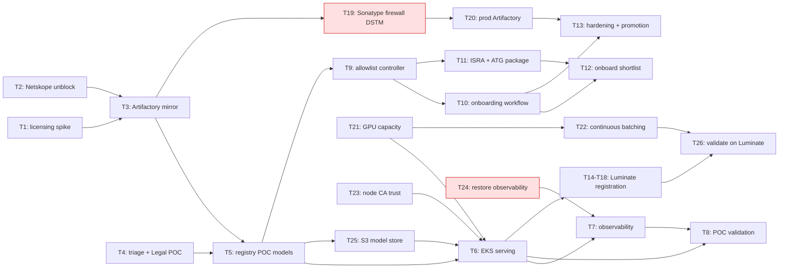

# Small Local Model (SLM) Pipeline — D3: Implementation Plan

> **Gate**: D3 — Tasks | **Status**: Draft | **Epic**: EACPP-557
> **Last reviewed**: 2026-08-24 against the delivered PoC in
> [`acp-slm-harness`](https://bitbucket.sunlifecorp.com/projects/EDAEACP/repos/acp-slm-harness)

## Delivery status at 2026-08-24

Phase 0 is substantially delivered. The PoC pulled Gemma through the Artifactory HF mirror,
served it in `eks-dev`, and proved governed inference through the AgentGateway. Evidence:
[PoC results](https://bitbucket.sunlifecorp.com/projects/EDAEACP/repos/acp-slm-harness/browse/docs/poc-results.md) ·
[CPU performance & cost](https://bitbucket.sunlifecorp.com/projects/EDAEACP/repos/acp-slm-harness/browse/docs/performance-benchmark-2026-08-16.md) ·
[GPU benchmark](https://bitbucket.sunlifecorp.com/projects/EDAEACP/repos/acp-slm-harness/browse/docs/gpu-benchmarking-results.md).

Three findings change the plan rather than just its status:

1. **The cost verdict reversed.** The 2026-08-16 CPU assessment concluded self-hosting could
   not break even against Bedrock "at any volume". On a single NVIDIA L4 (`g6.xlarge`) with
   fused attention and request batching the same model reaches **482 output tok/s at $0.53
   per 1M output tokens** versus Haiku's $1.25. On identical A10G hardware the software fix
   alone was worth **30×** ($21.42 → $0.71/1M); L4 took it down a further 26%. Cost is now a
   *supporting* argument for self-hosting above ~42% utilization, not an argument against it.
   Any steering material still quoting "17×" or "40× Bedrock" is measuring an unbatched
   server, not the hardware — and any material quoting **$0.82/1M at n=32 should also be
   withdrawn**: that figure did not reproduce (re-measured 2026-08-25 at 1.10× Haiku).
   Quote the n=96 figures, which are stable across runs.
2. **Serving runtime choice was wrong.** Ollama in the internal ECR is 0.6.8 — too old for the
   PoC model — and an unbatched `transformers` server wastes a GPU almost entirely. Batching is
   not an optimisation here; it is the difference between viable and not.
3. **NFR-2 is not met and is externally blocked.** Sonatype Repository Firewall screening was
   never enabled, so no cached model artifact has been scanned. It needs a **DSTM request**
   (T19) — the one genuinely outstanding Phase 0 governance control.

## Task Summary

| # | Task | Type | Points | Sprint | Phase | Depends On | Jira |
|---|------|------|--------|--------|-------|------------|------|
| T1 | Artifactory ML repo licensing + v7.104.15 layout spike | Spike | 2 | S1 | 0 | — | EACPP-558 |
| T2 | ISRA support + Netskope unblock (Artifactory-scoped egress) | Story | 3 | S1 | 0 | — | EACPP-559 |
| T3 | Artifactory HF/ML pull-through repo (dev) restricted to Gemma 3n + Sonatype firewall | Story | 5 | S1 | 0 | T1, T2 | EACPP-560 |
| T4 | Per-model GenAI Risk Triage + Legal review of POC models | Story | 2 | S1 | 0 | — | EACPP-561 |
| T5 | Register POC SLMs in ACP Model Registry (cards, pinned digests, artifacts) | Story | 3 | S2 | 0 | T3, T4 | EACPP-562 |
| T6 | SLM serving in EKS pulling from the governed store + Gateway wiring | Story | 5 | S2 | 0 | T5 | EACPP-563 |
| T7 | Observability — Langfuse traces + Prometheus metrics + audit for SLM inference | Story | 3 | S2 | 0 | T6, T24 | EACPP-564 |
| T8 | POC E2E validation + egress-containment verification | Story | 3 | S2 | 0 | T6, T7 | EACPP-565 |
| T9 | Registry-gated allowlist controller (Registry = source of truth) | Story | 5 | S3 | 1 | T5 | EACPP-566 |
| T10 | Self-service per-model onboarding workflow | Story | 5 | S3 | 1 | T9 | EACPP-567 |
| T11 | Generalized-pipeline ISRA + ATG submission package | Story | 3 | S3 | 1 | T9 | EACPP-568 |
| T12 | Onboard generalized model shortlist | Story | 5 | S4 | 1 | T10, T11 | EACPP-569 |
| T13 | Supply-chain hardening + multi-env promotion (SIT→prod) | Story | 3 | S4 | 1 | T10, T20 | EACPP-570 |
| T14–T18 | Luminate catalogue / gateway / registration integration | Story | — | — | 1 | T6 | EACPP-717–721 |
| **T19** | **Sonatype Repository Firewall enablement (DSTM request)** | Story | 3 | S1 | 0 | T3 | EACPP-1067 |
| **T20** | **Promote the HF mirror from stage to production Artifactory** | Story | 3 | S3 | 1 | T19 | EACPP-1068 |
| **T21** | **GPU capacity — Karpenter NodePool + NVIDIA device plugin** | Story | 3 | S2 | 0 | — | EACPP-1069 |
| **T22** | **Continuous-batching serving runtime (vLLM evaluation)** | Story | 5 | S3 | 1 | T21 | EACPP-1070 |
| **T23** | **Trust the Sun Life CA on cluster nodes for registry pulls** | Story | 2 | S2 | 0 | — | EACPP-1071 |
| **T24** | **Restore LLM observability (Langfuse ClickHouse + OTLP)** | Story | 3 | S2 | 0 | — | EACPP-1072 |
| **T25** | **S3 verified model store as the weight distribution path** | Story | 3 | S2 | 0 | T5 | EACPP-1073 |
| **T26** | **Validate + benchmark the SLM through Luminate (second control plane)** | Story | 5 | S3 | 1 | T14–T18, T22 | EACPP-1074 |

**Total**: ~47 points across the original 13 tasks, plus ~27 points of PoC-derived work
(T19–T26). **Phase 0 (POC)** = T1–T8, T19, T21, T23–T25; **Phase 1 (generalized)** = T9–T13,
T20, T22, T26.

> **All evidence to date is from the internal ACP build only.** The PoC proved governed
> inference through the ACP AgentGateway against the ACP Model Registry. Luminate is a second
> control plane with its own catalogue, gateway and credential model — nothing about the SLM path
> has been exercised there. T14–T18 cover *registration and wiring*; T26 covers *proving it works*.

## Dependency Graph

**Red = externally blocked.** T19 needs a DSTM request; T24 needs platform remediation. Both are
governance controls, not features — Phase 0 cannot be called complete while either is open.

## Sprint Allocation

### Sprint 1: POC foundation — unblock, mirror, triage

| Task | Points | Assignee | Definition of Done |
|------|--------|----------|-------------------|
| T1: licensing spike | 2 | TBD | Confirmed whether JFrog license covers v7.104.15 ML repo layout; decision + any licensing request recorded; D0 open question closed. |
| T2: Netskope unblock | 3 | TBD | ISRA support provided; `huggingface.co` egress applied **scoped to Artifactory hosts only**; verification record shows EKS has no direct path (NFR-1). |
| T3: Artifactory mirror | 5 | TBD | HF/ML pull-through remote configured (dev); include-pattern restricted to **Gemma 3n E2B/E4B**; Sonatype firewall screening on; criticals block; checksum + provenance retained. |
| T4: triage + Legal (POC) | 2 | TBD | Gemma 3n E2B/E4B pass GenAI Risk Triage + Legal review; reviewer/decision/date + Archer ID captured for the registry entry. |

### Sprint 2: POC serve & prove

| Task | Points | Assignee | Definition of Done |
|------|--------|----------|-------------------|
| T5: registry POC models | 3 | TBD | Gemma 3n E2B/E4B registered with model card, license, provenance, pinned `hf_repo_id`/revision/digest, approval state + Archer ID; no serving without `approved`. |
| T6: EKS serving | 5 | TBD | Serving pods in `acp-data` pull image+weights from Artifactory only; OpenAI-compatible endpoints registered with the Gateway; single-replica pods use `Recreate` (NFR-8). |
| T7: observability | 3 | TBD | Langfuse traces + Prometheus metrics (tokens/latency/errors) per inference; gateway decisions audited; Grafana view per model (NFR-7, NFR-9). |
| T8: POC validation | 3 | TBD | E2E inference via Gateway for both Gemma 3n variants in dev; verified EKS cannot reach HF directly; verified only approved models are servable (fail-closed). |

### Sprint 3: Registry-gated allowlist & generalized governance

| Task | Points | Assignee | Definition of Done |
|------|--------|----------|-------------------|
| T9: allowlist controller | 5 | TBD | Controller projects Registry approved set → Artifactory include-patterns + EKS pull/admission policy; unknown ⇒ deny; revocation enforced; drift raises finding; converge < 15 min (NFR-3, NFR-4). |
| T10: onboarding workflow | 5 | TBD | Documented + automated Request → Triage → Legal → Mirror → Registry Approval → Serve; any failed stage halts mirror/serve with recorded reason. |
| T11: ISRA + ATG package | 3 | TBD | Separate Phase 1 ISRA + ATG submission package prepared (generalized pipeline, allowlist controls, expanded shortlist) and submitted for InfoSec + EA review. |

### Sprint 4: Scale-out

| Task | Points | Assignee | Definition of Done |
|------|--------|----------|-------------------|
| T12: onboard shortlist | 5 | TBD | Qwen 3.6 27B, Gemma 4 12B, Qwen 2.5 Coder 14B, Gemma 2 9B each onboarded via the workflow (triage→Legal→approve→mirror→serve); gated by Phase 1 ISRA/ATG approval. |
| T13: hardening + promotion | 3 | TBD | safetensors-only enforced (no pickle); checksum/provenance retention verified; promotion path dev→SIT→prod defined and exercised for one model. |

## Task Details

### T1: Artifactory ML repo licensing + v7.104.15 layout spike
**Type**: Spike | **Points**: 2 | **Sprint**: S1 | **Phase**: 0
**Description**: Confirm the JFrog license covers the v7.104.15 ML repo layout (HF layout) before repo config.
**Acceptance Criteria**:
- [ ] Licensing answer documented (covered / needs extension).
- [ ] Any licensing/procurement request ticketed.
- [ ] D0 open question on ML repo licensing closed.

---

### T2: ISRA support + Netskope unblock (Artifactory-scoped)
**Type**: Story | **Points**: 3 | **Sprint**: S1 | **Phase**: 0
**Description**: Support the in-flight ISRA and apply the Netskope unblock for `huggingface.co` scoped to Artifactory servers only.
**Acceptance Criteria**:
- [ ] Egress to `huggingface.co` allowed from Artifactory hosts only.
- [ ] EKS `acp-data` cannot reach `huggingface.co` directly (verified).
- [ ] Verification + monitoring record retained (NFR-1).

---

### T3: Artifactory HF/ML pull-through repo (dev), restricted to Gemma 3n
**Type**: Story | **Points**: 5 | **Sprint**: S1 | **Phase**: 0 | **Depends on**: T1, T2
**Description**: Configure the HF/ML remote (pull-through) repository with an include-pattern allowlist and Sonatype Repository Firewall screening (D2 §Artifactory).
**Acceptance Criteria**:
- [x] Pull-through caches allowlisted HF repo IDs — verified against `stage-artifactory` with a JFrog identity token; cache-deploy permission granted (PoC §9.1).
- [ ] **Sonatype Repository Firewall screens every cached component; criticals block (NFR-2)** — **not enabled; moved to T19** (needs a DSTM request).
- [ ] Non-allowlisted repo IDs are not cached or served — include-pattern restriction still to be asserted negatively.
- [x] Checksum + provenance retained as artifact properties (NFR-5).

**Carried findings** (PoC §9.3–9.4, §12.9 P3/P4): the mirror stalls on un-cached blobs and one
stalled multi-GB fetch starves the whole remote repo's connection pool. Netskope must cover
`*.aws.cdn.hf.co` and `*.xethub.hf.co`, not just `huggingface.co`. Mitigate client-side with
**short per-attempt timeouts and many retries** — the failure mode is a stall, not an error, so a
long timeout converts a retryable stall into a hang.

---

### T4: Per-model GenAI Risk Triage + Legal review (POC models)
**Type**: Story | **Points**: 2 | **Sprint**: S1 | **Phase**: 0
**Description**: Run GenAI Risk Triage + Legal review for Gemma 3n E2B/E4B and capture artifacts.
**Acceptance Criteria**:
- [ ] License, provenance, safety, and data-flow reviewed per model.
- [ ] Reviewer, decision, date, and Archer ID (interim) captured.
- [ ] No model proceeds to registry approval without sign-off.

---

### T5: Register POC SLMs in ACP Model Registry
**Type**: Story | **Points**: 3 | **Sprint**: S2 | **Phase**: 0 | **Depends on**: T3, T4
**Description**: Register Gemma 3n E2B/E4B with model cards, pinned digests, and approval artifacts (D2 §Model Registry).
**Acceptance Criteria**:
- [ ] Entry records `hf_repo_id`, pinned revision/digest, license, provenance, Archer ID, model card.
- [ ] Approval state requires `triaged` + `legal_reviewed` ⇒ `approved`.
- [ ] No serving permitted unless `approved` (fail-closed).

---

### T6: SLM serving in EKS + Gateway wiring
**Type**: Story | **Points**: 5 | **Sprint**: S2 | **Phase**: 0 | **Depends on**: T5
**Description**: Deploy serving pods pulling weights from the governed store; register OpenAI-compatible endpoints with the Gateway (D2 §EKS serving, Flow 2).
**Acceptance Criteria**:
- [x] Pods pull image + weights from internal sources only (ECR image + S3 verified release); no internet at pod start.
- [x] OpenAI-compatible inference works via the AgentGateway with policy/guardrails — verified end to end (PoC §12.8).
- [x] Single-replica pods use `Recreate` strategy on CPU-tight nodes (NFR-8).

**Deviations from D2 to fold back into the design**:

- Namespace was **`acp-slm-test`**, not `acp-data`.
- Runtime was a **hand-rolled `transformers` server**, not Ollama — the internal ECR only carries
  **Ollama 0.6.8**, too old for the PoC model (§12.9 P5).
- Routing needed an `acp-management-gateway` `ModelRoute` change to support a non-Bedrock
  provider (§12.9 P10) — fixed and deployed to `eks-dev`; **still needs a CI release build**.
- `agentgateway` 1.1.0 accepts but **does not apply** `params.pathOverride` (§12.9 P15); address
  the cluster Service directly, not a published ingress path.

---

### T7: Observability for SLM inference
**Type**: Story | **Points**: 3 | **Sprint**: S2 | **Phase**: 0 | **Depends on**: T6, T24
**Description**: Emit Langfuse traces + Prometheus metrics and audit gateway decisions (D2 §Observability).
**Acceptance Criteria**:
- [ ] Trace + metrics (tokens, latency, errors) per inference (NFR-7) — **blocked by T24**.
- [x] Gateway policy/guardrail decisions audited with model id + outcome (NFR-9).
- [ ] Grafana dashboard shows SLM metrics per model.

**NFR-7 cannot currently be met.** The traces are emitted correctly and nobody receives them:
Langfuse has dropped every trace since 2026-08-11 because its ClickHouse PVC is full, and ingest
returns success while discarding downstream, so nothing alerts (§12.9 P18). The Splunk OTLP trace
exporter also fails permanently — the endpoint does not implement the OTLP trace service
(§12.9 P19). Both are platform faults, tracked as T24.

---

### T8: POC E2E validation + egress containment
**Type**: Story | **Points**: 3 | **Sprint**: S2 | **Phase**: 0 | **Depends on**: T6, T7
**Description**: Validate the full POC and prove containment.
**Acceptance Criteria**:
- [ ] Gemma 3n E2B + E4B both serve end-to-end via the Gateway in dev.
- [ ] EKS confirmed unable to reach `huggingface.co` directly.
- [ ] Only registry-approved models are servable (un-approved attempts denied + audited).

---

### T9: Registry-gated allowlist controller
**Type**: Story | **Points**: 5 | **Sprint**: S3 | **Phase**: 1 | **Depends on**: T5
**Description**: Reconcile the Registry approved set into Artifactory include-patterns + EKS pull/admission policy (D2 §Allowlist Controller, Flow 3).
**Acceptance Criteria**:
- [ ] Pullable/servable set ⊆ Registry approved set (NFR-3); unknown ⇒ deny.
- [ ] Revocation removes the allowlist entry and scales serving down.
- [ ] Drift raises a governance finding; Registry wins; converge < 15 min (NFR-4).

---

### T10: Self-service per-model onboarding workflow
**Type**: Story | **Points**: 5 | **Sprint**: S3 | **Phase**: 1 | **Depends on**: T9
**Description**: Implement the Request → Triage → Legal → Mirror → Registry Approval → Serve workflow (D2 Flow 1).
**Acceptance Criteria**:
- [ ] Passing all stages auto-enables mirror + serve via the allowlist.
- [ ] Any failed stage halts mirror/serve with a recorded reason.
- [ ] Workflow is documented and repeatable per model.

---

### T11: Generalized-pipeline ISRA + ATG submission package
**Type**: Story | **Points**: 3 | **Sprint**: S3 | **Phase**: 1 | **Depends on**: T9
**Description**: Prepare and submit the **separate** Phase 1 ISRA + ATG package for the generalized pipeline.
**Acceptance Criteria**:
- [ ] Package documents the generalized pipeline, registry-gated allowlist controls, and expanded shortlist.
- [ ] ISRA (InfoSec) and ATG (EA) reviews requested and tracked.
- [ ] Phase 1 model onboarding is gated on this approval.

---

### T12: Onboard generalized model shortlist
**Type**: Story | **Points**: 5 | **Sprint**: S4 | **Phase**: 1 | **Depends on**: T10, T11
**Description**: Onboard Qwen 3.6 27B, Gemma 4 12B, Qwen 2.5 Coder 14B, Gemma 2 9B via the workflow.
**Acceptance Criteria**:
- [ ] Each model passes triage → Legal → registry approval → mirror → serve.
- [ ] Onboarding gated on Phase 1 ISRA/ATG approval (T11).
- [ ] Each model has pinned digest + model card + Archer ID.

---

### T13: Supply-chain hardening + multi-env promotion
**Type**: Story | **Points**: 3 | **Sprint**: S4 | **Phase**: 1 | **Depends on**: T10, T20
**Description**: Harden supply chain and define dev→SIT→prod promotion (D2 §Security Controls).
**Acceptance Criteria**:
- [ ] safetensors-only enforced; no arbitrary pickle execution (NFR-6).
- [ ] Checksum/provenance retention verified end-to-end (NFR-5).
- [ ] dev→SIT→prod promotion path defined and exercised for one model.

---

### T19: Sonatype Repository Firewall enablement (DSTM request)
**Type**: Story | **Points**: 3 | **Sprint**: S1 | **Phase**: 0 | **Depends on**: T3
**Description**: Enable Sonatype Repository Firewall screening on the HF/ML pull-through remote.
This is the compensating control the ISRA and the Netskope submission both rely on to justify
**bypassing TLS decryption** for multi-GB weight downloads — so until it is on, that argument is
unbacked and **NFR-2 is unmet**.

Enablement is not self-service: it requires a **DSTM request** through the ServiceNow catalogue.
Points of contact are **Navdeep Joshi** and **Nuno Inacio**.

**Acceptance Criteria**:
- [ ] DSTM request raised via the [ServiceNow catalogue item](https://sunlife.service-now.com/sunlifesp?id=sc_cat_item&sys_id=c6703fcddbe63200de73b96c4e96195a&table=sc_cat_item) and tracked to completion.
- [ ] Firewall screening active on the HF/ML remote; every cached component is screened.
- [ ] A component with a critical finding is demonstrably **blocked**, not merely reported (NFR-2).
- [ ] Screening evidence retained as an artifact property alongside checksum + provenance.
- [ ] D2 §Security Controls updated to state the control is live rather than planned.

**Risk if skipped**: model weights are the one artifact class in the estate pulled from the public
internet *and* exempted from TLS inspection. With no firewall screening there is no supply-chain
control on that path at all.

---

### T20: Promote the HF mirror from stage to production Artifactory
**Type**: Story | **Points**: 3 | **Sprint**: S3 | **Phase**: 1 | **Depends on**: T19
**Description**: The PoC ran entirely against **`stage-artifactory.sunlifecorp.com`**. The
Artifactory team has asked whether this should move to **production Artifactory**; that decision is
a prerequisite for any non-dev serving and for T13's promotion path. Artifactory-side optimisation
work is also planned in stage/dev and is not expected to affect this setup.

**Acceptance Criteria**:
- [ ] Decision recorded: remain on stage, or promote to production Artifactory, with rationale.
- [ ] If promoting — HF/ML remote, include-patterns, AD-group restriction and Sonatype screening
      reproduced in production; Netskope egress allowlist extended to the production egress.
- [ ] Model-registry pinned digests re-verified against the production mirror.
- [ ] Confirm the mirror is restricted to the **SLM AD group** in whichever instance is canonical
      (carried open item from PoC §10).

---

### T21: GPU capacity — Karpenter NodePool + NVIDIA device plugin
**Type**: Story | **Points**: 3 | **Sprint**: S2 | **Phase**: 0
**Description**: CPU serving is not viable for interactive use (1.5 tok/s, ~11 min for a
1,508-token prompt). GPU capacity is therefore a Phase 0 dependency, not a Phase 1 nicety.
Proven working in `eks-dev` on 2026-08-24; manifests are committed in the harness repo and need
folding into `acp-deploy`.

**Acceptance Criteria**:
- [x] Karpenter GPU NodePool + EC2NodeClass exist and provision on demand
      ([`deploy/gpu-nodepool.yaml`](https://bitbucket.sunlifecorp.com/projects/EDAEACP/repos/acp-slm-harness/browse/deploy/gpu-nodepool.yaml)).
- [x] NVIDIA device plugin advertises `nvidia.com/gpu`
      ([`deploy/nvidia-device-plugin.yaml`](https://bitbucket.sunlifecorp.com/projects/EDAEACP/repos/acp-slm-harness/browse/deploy/nvidia-device-plugin.yaml)).
- [x] Serving workload admits **both** `g5` and `g6` rather than pinning one family
      ([`deploy/serve-gpu-deployment.yaml`](https://bitbucket.sunlifecorp.com/projects/EDAEACP/repos/acp-slm-harness/browse/deploy/serve-gpu-deployment.yaml)).
- [ ] **GPU selection actually lands on the cheapest fulfillable family.** Given `g5` and `g6`,
      Karpenter selected the dearer `g5.xlarge` while `g6` capacity was available. Either
      constrain the family explicitly or change the fleet allocation policy, then prove the
      selection with a provisioned node.
- [ ] Manifests promoted into `acp-deploy` as the owned, reviewed home.
- [ ] Capacity model agreed (on-demand vs reserved) and a cost guardrail defined.

**Findings that must carry forward**:

- Karpenter is installed cluster-wide but shipped with **zero NodePools** and no
  `karpenter.sh/discovery` tags (§12.9 P7), so subnets/SGs must be pinned by ID — which will not
  survive promotion to another account. **Ask the cloud team to tag them.**
- `EC2NodeClass` must use a **pre-created `instanceProfile`**, not `role`. With `role`, Karpenter
  calls IAM `CreateInstanceProfile`, and IAM is global-only with no regional endpoint and no
  PrivateLink — the call never completes from this isolated VPC.
- **Do not pin a single GPU instance family.** `g6`/L4 returned `UnfulfillableCapacity` in
  `ca-central-1` on 2026-08-24, but provisioned on first attempt on 2026-08-25 — the refusal was
  transient, not structural. `g6` is offered in **3** AZs (1a, 1b, 1d) against `g5`'s **2** (1a,
  1b), so L4 is the *less* capacity-constrained family. Allow both `g5` and `g6`; pinning one
  turns a transient regional shortfall into an outage.
- **Allowing both families buys availability, not cost.** Given both, Karpenter still selected the
  dearer `g5.xlarge` while `g6` capacity was available. Realising L4 pricing needs an explicit
  family request or a fleet-policy change — open item on T21.
- **`inf2`/Inferentia is out of scope** — not offered in `ca-central-1` at all, so it cannot serve
  a Canadian-resident workload regardless of price or throughput.
- Exclude `g4dn`/T4 for bf16 workloads — Turing has no native bf16 and silently degrades.

---

### T22: Continuous-batching serving runtime (vLLM evaluation)
**Type**: Story | **Points**: 5 | **Sprint**: S3 | **Phase**: 1 | **Depends on**: T21
**Description**: Batching is the single largest cost lever measured on this programme. Adding
*static* batching to the PoC server took throughput from 14.8 → 444.74 tok/s on A10G and cost from
$21.42 → $0.71 per 1M output tokens; L4 then reached 481.93 tok/s at $0.53. Continuous batching
(vLLM/TGI) removes the two remaining limits — a batch runs to its longest request, and no request
can join a batch already in flight. It should also remove the batch-boundary sensitivity that made
the mid-range concurrency figures irreproducible.

**Acceptance Criteria**:
- [ ] vLLM (or TGI) evaluated on the **same** `g6.xlarge`, same model, same benchmark harness.
- [ ] Throughput ≥ 2× the current 482 tok/s, or a recorded explanation of why not.
- [ ] Mid-range concurrency points reproduce within 10% across two runs.
- [ ] Cost per 1M output tokens re-measured at the achieved utilization.
- [ ] Decision recorded on the production serving runtime, superseding D2 decision #8.
- [ ] Model-load and cold-start time measured — it gates replica scale-out, not just steady state.

---

### T23: Trust the Sun Life CA on cluster nodes for registry pulls
**Type**: Story | **Points**: 2 | **Sprint**: S2 | **Phase**: 0
**Description**: EKS nodes reach `artifactory.sunlifecorp.com` but do not trust the Sun Life
internal CA, so containerd aborts the TLS handshake with `x509: certificate signed by unknown
authority`. The CA in the repo only helps *inside* containers; image pulls happen on the host.

**Acceptance Criteria**:
- [ ] Sun Life CA present in the node trust store, or a `/etc/containerd/certs.d/` host entry for
      `artifactory.sunlifecorp.com`, applied via the node AMI or Karpenter `userData`.
- [ ] A pod pulling an Artifactory-hosted image starts without a per-image ECR round-trip.

**Standing tax if unfixed**: every Artifactory-hosted image must be manually pulled and re-pushed
to ECR before the cluster can run it. That was the workaround used for the NVIDIA device plugin
and it does not scale.

---

### T24: Restore LLM observability (Langfuse ClickHouse + OTLP)
**Type**: Story | **Points**: 3 | **Sprint**: S2 | **Phase**: 0
**Description**: All LLM observability is being silently discarded, which makes NFR-7 unmeetable
and removes the evidence base for cost and usage reporting.

**Acceptance Criteria**:
- [ ] Langfuse ClickHouse volume expanded; retention/TTL policy set (§12.9 P18).
- [ ] Disk-utilisation alarm added so a full volume is never silent again.
- [ ] Splunk OTLP trace endpoint either implements the trace service or is removed from the
      collector config (§12.9 P19).
- [ ] A test inference produces a trace that is queryable end to end.

**Why this is severity-worthy**: Langfuse ingest returns **success** and discards downstream, so
the collector reports no error. Every trace since 2026-08-11 has been lost with no alert.

---

### T25: S3 verified model store as the weight distribution path
**Type**: Story | **Points**: 3 | **Sprint**: S2 | **Phase**: 0 | **Depends on**: T5
**Description**: Serving pods no longer mount a PVC. An approved model is promoted once into a
content-addressed S3 release and hydrated into pod-local storage at start, with every file
verified. This removes the RWO/multi-attach constraint that blocked independent replicas, and
removes Artifactory from the pod start path entirely.

**Acceptance Criteria**:
- [x] Releases addressed by a **complete-manifest SHA-256**; the manifest is published last, so a
      partial upload can never be served
      ([`scripts/s3_model_store.py`](https://bitbucket.sunlifecorp.com/projects/EDAEACP/repos/acp-slm-harness/browse/scripts/s3_model_store.py)).
- [x] Every object read back from S3 and hashed before the release is published; every file
      re-verified on download.
- [x] Least-privilege IRSA under the mandated `/delegated/` path with the permissions boundary —
      reader is list/get on one pinned release, promoter has no delete.
- [ ] Bucket + IAM roles provisioned by Terraform in `acp-deploy` rather than by hand (carried
      open item from PoC §10).
- [ ] Promotion wired into the onboarding workflow (T10) as an explicit stage.

**Trade-off to accept knowingly**: no PVC means each new pod downloads ~10.2 GB before readiness
(~161 s hydration, ~181 s to Ready). That buys disposable pods and independent replicas at the
cost of rollout speed.

---

### T26: Validate + benchmark the SLM through Luminate
**Type**: Story | **Points**: 5 | **Sprint**: S3 | **Phase**: 1 | **Depends on**: T14–T18, T22
**Assignee**: Kieran Gibney
**Description**: Every result in this spec was measured against the **internal ACP build** — the
ACP AgentGateway, the ACP Model Registry, and `acp-agentcore-sample`. Luminate is a separate
control plane with its own catalogue, `/llm` gateway, bearer-auth model and portal-issued
credentials. T14–T18 (EACPP-717–721) register and wire the SLM into Luminate; **none of them
prove it serves**, and no performance or governance evidence exists on that path.

This task repeats the ACP validation on Luminate so the two control planes are comparable and the
SLM is not accidentally ACP-only.

**Acceptance Criteria**:
- [ ] Onboard the SLM following the **Luminate User Guides** path — register the model, obtain
      access and be issued credentials in the portal — rather than by direct API poking, so the
      documented operator journey is exercised.
- [ ] Governed inference succeeds through the **Luminate `/llm` gateway**, with policy and
      guardrail decisions audited on the Luminate side.
- [ ] A consumer reaches the SLM using **`acp-aws-harness-sdk` with `ACP_TARGET=luminate`**,
      unchanged apart from configuration — this is the SDK's portability claim and it has not been
      tested against a self-hosted model.
- [ ] Re-run [`scripts/bench.py`](https://bitbucket.sunlifecorp.com/projects/EDAEACP/repos/acp-slm-harness/browse/scripts/bench.py)
      through the Luminate gateway and record gateway overhead, throughput and cost per 1M output
      tokens alongside the ACP numbers.
- [ ] Record what is **portal-only** on Luminate and therefore not automatable yet.
- [ ] Any divergence in governance behaviour between the two control planes is written up as a
      finding, not silently accepted.

**References**:

- [Luminate User Guides](https://bitbucket-static.sunlifecorp.com/pages/EDAEACP/luminate-user-guides/bb-pages/browse/)
  — the primary onboarding path (register, get model access, credentials in the portal).
- [acp-aws-harness-sdk — Targeting Luminate](https://bitbucket-static.sunlifecorp.com/pages/T1KACP/acp-aws-harness-sdk/bb-pages/browse/luminate-target/)
  — `ACP_TARGET=luminate`, the `/llm` gateway, bearer auth, and what remains portal-only.
- EACPP-717–721 (T14–T18) — the Luminate registration and wiring this validates.

**Why it matters**: if the SLM only works on ACP, the "self-hosted small model" capability is tied
to one control plane. The cheap-inference argument only generalises if it holds on both.

## Risk Mitigation

| Risk (from D0) | Mitigation Task | Sprint |
|-----------------|----------------|--------|
| Broad internet exposure | T2 Artifactory-scoped unblock + T8 containment verification | S1/S2 |
| Malicious / unvetted model | **T19 Sonatype firewall (open)** + T4 triage/Legal + T9 registry-gated allowlist | S1/S3 |
| Unsafe weights / embedded code | T13 safetensors-only, no pickle | S4 |
| Artifactory ML licensing | T1 spike | S1 |
| Allowlist drift | T9 reconcile-not-drift, Registry wins | S3 |
| Data leakage at inference | T6 VPC serving + T7 audit/observability | S2 |
| **Unscanned weights on a TLS-bypassed path** | **T19 — currently unmitigated; the ISRA's compensating control is not live** | **S1** |
| **Governance evidence silently lost** | **T24 — Langfuse discards traces while reporting success** | **S2** |
| **Cost case misquoted from stale CPU data** | Re-quote from the GPU benchmark; the CPU-only figures are 30× pessimistic, and the superseded $0.82/1M n=32 figure did not reproduce | — |
| **Serving economics collapse at low utilization** | T22 + consolidate workloads; break-even vs Haiku is ~42% duty cycle on L4 (~57% on A10G) | S3 |
| **Capacity assumed but unavailable** | T21 — allow both `g5` and `g6`; the 2026-08-24 L4 refusal was transient and `g6` covers one more AZ than `g5` | S2 |
| **Capability proven on one control plane only** | T26 — all evidence is internal-ACP; Luminate is unexercised | S3 |

## Jira Ticket Map

> Maps task numbers to Jira keys under epic EACPP-557. Labels on every issue: `acp`, `spec-driven`, `component:slm-pipeline`, `acp-slms`, `gate:d3`.
> Status column reflects Jira at **2026-08-24** after reconciliation against the delivered PoC.

| Task | Jira Key | Status | Evidence / blocker |
|------|----------|--------|--------------------|
| T1 | EACPP-558 | Funnel | Licensing answer still not recorded; D0 open question remains open |
| T2 | EACPP-559 | **Done** | Netskope unblock applied and verified |
| T3 | EACPP-560 | Implementing | Mirror works; Sonatype screening split to T19 |
| T4 | EACPP-561 | **Done** | Triage + Legal complete **for PoC scope only**; must be re-run before non-PoC use |
| T5 | EACPP-562 | **Done** | Model registered and `active` in the Model Registry (PoC §12.8) |
| T6 | EACPP-563 | **Done** | Governed inference verified through the AgentGateway (PoC §12.8) |
| T7 | EACPP-564 | Implementing | Blocked by T24 — traces emitted but discarded |
| T8 | EACPP-565 | Implementing | E2E verified; re-verify after the management-gateway release build |
| T9 | EACPP-566 | Funnel | Phase 1 |
| T10 | EACPP-567 | Funnel | Phase 1 |
| T11 | EACPP-568 | Funnel | Phase 1 |
| T12 | EACPP-569 | Funnel | Phase 1 |
| T13 | EACPP-570 | Funnel | Phase 1; now also depends on T20 |
| T14–T18 | EACPP-717–721 | Funnel | Luminate integration |
| T19 | EACPP-1067 | Funnel | **Externally blocked** — DSTM request; contacts Navdeep Joshi / Nuno Inacio |
| T20 | EACPP-1068 | Funnel | Decision needed: stage vs production Artifactory |
| T21 | EACPP-1069 | Funnel | Delivered in harness; promote to `acp-deploy` |
| T22 | EACPP-1070 | Funnel | The remaining cost lever |
| T23 | EACPP-1071 | Funnel | Platform ask |
| T24 | EACPP-1072 | Funnel | Platform ask; blocks NFR-7 |
| T25 | EACPP-1073 | Funnel | Delivered in harness; Terraform + workflow wiring outstanding |
| T26 | EACPP-1074 | Funnel | Luminate validation — all evidence to date is internal-ACP only; assigned to Kieran Gibney |

Related defects raised from this work: **EACPP-988** (oversized governance tag validated on read,
not write — one bad row 500s `GET /models` for every model) and **EACPP-989**
(`POST /models/{id}/approve` sets `status=active` but leaves `approval_status=proposed`).

## Notes

- **Phase 0 (T1–T8)** rides the in-flight ISRA, lands in dev only, and is restricted to the
  approved PoC models.
- **Phase 1 (T9–T13)** requires a **separate ISRA + ATG submission** (T11) before the expanded
  shortlist (T12) is onboarded.
- The **ACP Model Registry approved set is the single source of truth** for which models can be
  mirrored, pulled, and served — enforced fail-closed by the allowlist controller (T9).
- EKS never reaches `huggingface.co`; Artifactory is the only egress path (T2/T8).
- Canonical HF repo IDs/digests for every model are pinned at triage time and recorded on the
  Registry entry.
- **The cost argument has reversed and should be re-quoted.** The CPU-only assessment concluded
  self-hosting could not break even against Bedrock at any volume. With a GPU and a batched server
  the same model costs **$0.53/1M output tokens against Haiku's $1.25** on L4. The earlier figures
  measured an unbatched server, not the hardware, and should not be presented to steering.
- **Quote the n=96 figures only.** The previously published **$0.82/1M at n=32 did not reproduce**
  — re-measured on identical hardware and image digests at 230 tok/s, which is 1.10× Haiku. Static
  batching makes mid-range concurrencies sit on a batch boundary. The endpoints are stable.
- **The economics are conditional on utilization**, which makes workload consolidation a design
  requirement rather than an optimisation: break-even against Haiku is roughly **42% duty cycle on
  L4** (**57%** on A10G) at high concurrency. An idle GPU remains worse than Bedrock.
- **Throughput and latency want different operating points.** The cheapest point per token (n=96)
  takes 3.19 s and breaches a 2 s p95 target; a latency-bounded service should size at n=32, where
  L4 still returns $0.63/1M against Haiku's $1.25.
- **Timeouts are a design decision on this path.** Artifactory's failure mode is a stall, not an
  error; short per-attempt timeouts with many retries succeed where long timeouts hang (§12.7).
