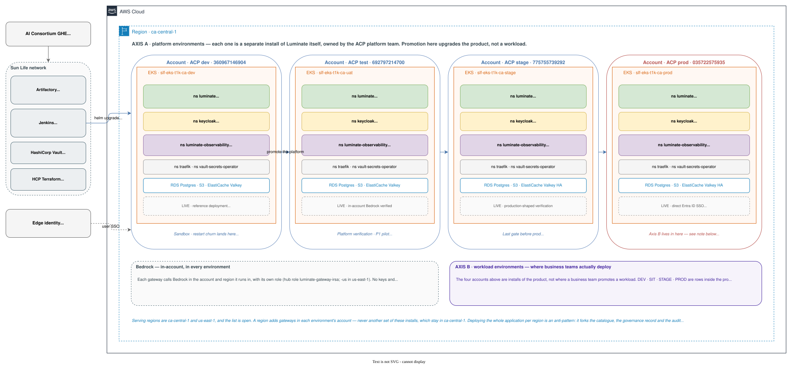
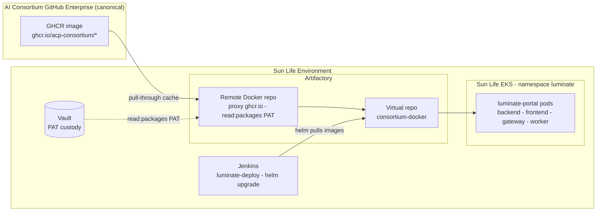
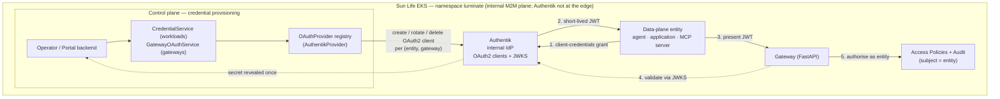

# Sun Life Deployment of Luminate — D2: Design

> **Gate**: D2 — Design | **Status**: Draft | **Epic**: [EACPP-596](https://sunlife.atlassian.net/browse/EACPP-596)
> **D1 Approved**: TBD

## Table of Contents

## The architecture

The Sun Life deployment forks the upstream `luminate-portal` Helm chart and layers Sun Life
platform integrations on top. Base infrastructure — EKS, VPC, nodes — is provided by the Sun Life
Cloud Engineering Platform and Pipelines, not self-provisioned.

Everything else in this D2 is a consequence of that picture. Two things it is deliberate about.

**The four accounts are installs of Luminate itself.** They are not the environments a business
team promotes a workload through. Promoting along that row upgrades the *product*.

**There is one install per account, and it is in `ca-central-1`.** Luminate *serves* more than one
region — `ca-central-1` and `us-east-1` today, and the list is open — but a region adds gateways,
never another set of these four installs. Deploying the whole application per region is an
anti-pattern: it forks the catalogue, the governance record and the audit trail, so the same agent
registered in two regions becomes two unrelated resources. The rule for adding a region is
`gateway-environment-strategy` DD-19.

## What these four environments are — and are not

This is the single most common misreading of this spec, so it is worth stating plainly.

The `dev` / `test` / `stage` / `prod` accounts above are **platform environments** — four separate
installs of Luminate, each with its own EKS cluster, database and credentials, owned and operated
by the ACP platform team. Promotion across them is a **product upgrade**: it proves a new Luminate
release before it reaches the install that carries live traffic.

They are **not** where a business team's DEV, SIT, STAGE and PROD workloads live. Those are
**workload environments** — rows *inside* the production install, each served by its own gateway,
sharing one catalogue, one governance record and one audit trail.

**The same accounts host both, and they stay separate.** In the target topology each workload
environment's gateways run in that environment's account — DEV in `dev`, SIT in `test`, STAGE in
`stage`, PROD in `prod` — in each serving region, and reach the production control plane over one
outbound, content-free control link. So the `dev` account runs both its own platform install and
the production control plane's DEV gateways. They share an account and nothing else: the gateways
answer only to the prod install, and the lower installs stay platform-only — they test Luminate
releases, never workloads (`gateway-environment-strategy` DD-3, DD-13, DD-18). Until the move, all
eight gateways run in the prod account.

The distinction is owned by the
[`gateway-environment-strategy`](../gateway-environment-strategy/d2-design.md) spec, which calls
them Axis A and Axis B. That spec is the authority on how many gateways exist, which environments
enforce governance, and how cross-environment traffic is controlled.

**This spec stops at the platform boundary.** It says how a Luminate install is built and promoted,
not how workloads move through the one running in production.

Where this spec says *environment* unqualified, it means **platform environment** — the opposite of
the convention in `gateway-environment-strategy`, because the two documents sit on opposite sides
of that boundary.

## Governance records

**APM0006505** is the APM record for ACP. It replaced **APM0004443**, which some AWS resource tags
still carry; those tags are a re-tagging action, not a second record.

Two architectural approvals cover this deployment and they are **scoped differently**. Citing the
wrong one is the usual way a settled approval question gets re-opened. A third, for the gateway
topology, is being raised.

| Scope | ATG | ISRA | Covers |
|---|---|---|---|
| ACP platform | **ATG0005196** | [**26-0739**](https://sunlife.service-now.com/nav_to.do?uri=x_sulfc_vendor_ass_vendor_assessment.do%3Fsys_id=aa746aeb3b4cc310e9d4223eb3e45ae5) | The platform and its supporting components — **Langfuse, ClickHouse, Valkey** and the rest of the deployed tier |
| Internal M2M IdP | [**ATG0005518**](https://sunlife.service-now.com/atg?id=ticket&table=x_sulfc_atg_request&sys_id=34e9753e2b06cb547c8ef5e2fe91bf7f&view=atg_controller_review) | [**26-1565**](http://sunlife.service-now.com/nav_to.do?uri=x_sulfc_vendor_ass_vendor_assessment.do%3Fsys_id=8b1cf13a2b46cb547c8ef5e2fe91bf79) | **Keycloak / Authentik** as the M2M issuer for this workload — ETAB presented, approval granted ([EACPP-747](https://sunlife.atlassian.net/browse/EACPP-747)) |
| Gateway topology | Being raised | Being raised | Gateways in each environment's account and serving region, and the control link to the one control plane — a delta on the platform approval. The package is the `gateway-environment-strategy` Assurance page ([EACPP-1089](https://sunlife.atlassian.net/browse/EACPP-1089)) |

The IdP approval is deliberately the narrower of the two. It is scoped to **agentic M2M for this
workload** — explicitly not an enterprise IdP, and not edge-exposed. Widening that scope is a new
governance conversation, not a configuration change.

## Container Image Sourcing — Artifactory Mirror of GHCR

Luminate container images (`backend`/Django, `frontend`/Nuxt, `gateway`/FastAPI, `dbos-worker`, and
the Langfuse/ClickHouse tier) are built by the **consortium's GitHub Actions** and published to
**GHCR** under `ghcr.io/acp-consortium/*`.

Those Actions are hosted in the AI Consortium **GitHub Enterprise (GHE)** organization. The
consortium is migrating its existing GitHub into GHE, but the GHCR → Artifactory mirror below is
unchanged regardless of where the source is hosted.

The Sun Life deployment **never pulls from GHCR directly** — no deploy-time egress to GitHub, and
no engineer or cluster presents a GitHub identity.

Instead, **Artifactory fronts GHCR as a pull-through mirror**:

- A **Remote (pull-through) Docker repository** proxies `ghcr.io`, authenticated with a classic `read:packages` PAT (**PAT #3**, provisioned by the Lightworks team and held in **Vault**). The first pull of a tag caches the image inside Sun Life; subsequent pulls are served locally and Xray-scanned.
- A **Virtual repository (`consortium-docker`)** aggregates the remote so consumers use one stable registry hostname.
- The forked `luminate-portal` Helm chart's `image.registry` / `image.repository` values point at the Artifactory virtual repo, so `helm upgrade` from the `luminate-deploy` Jenkins job pulls **mirrored, scanned** images from inside the Sun Life network onto the managed EKS cluster (namespace `luminate`).

This is the **container-image half of the Consortium Code & Artifact Sharing design** (flow **E — Artifact mirror + deploy**); see the `consortium-code-sharing` D2 spec for the full mechanism, PAT inventory, and Bitbucket source-mirror counterpart. Image provenance therefore stays inside Sun Life (Xray + no direct GHCR egress at deploy time) while tracking upstream consortium releases.

## Key Design Decisions

### DD-1 — Fork the Helm chart, don't inherit `luminate-deploy`
Upstream `luminate-deploy` self-provisions infra Sun Life already manages. We fork
only the `luminate-portal` chart into `EDAEACP/luminate-sunlife-deploy` and keep
Sun Life differences in `values/values-<env>.yaml` plus Sun Life-specific chart
templates under `templates/slf/`. See `docs/fork-lineage.md`.

### DD-2 — Single Helm release (all-Helm)
The whole deploy is **one `helm upgrade --install`**. Sun Life platform resources
(Traefik `HTTPRoute`, Vault Secrets Operator resources) are **chart templates** under
`templates/slf/`, gated by `.Values.slf` and parameterised per env in
`values/values-<env>.yaml` — there is **no separate Kustomize step**. This keeps a
single tool/source of truth while the forked chart stays close to upstream.

### DD-3 — Ingress: Traefik / Gateway API
The chart's ALB IngressClass/IngressClassParams templates are **removed** from the
fork; routing is a Gateway API `HTTPRoute` chart template
(`templates/slf/httproute.yaml`, `.Values.slf.traefik`). API Platform onboarding
fronts the HTTP surfaces with a light-proxy sidecar (Okta JWT). The gRPC control
plane (`:50051`) stays internal via NetworkPolicy.

> **Upstream (partner-confirmed):** AWS **ALB on EKS Auto Mode**, **classic Ingress
> API only** (no Gateway API). Moving to Traefik/Gateway API requires rewriting the
> ingress layer and **re-homing the AWS-native ALB features** (TLS, WAF, access
> logs). Upstream egress is open at the pod/NetworkPolicy layer but assumes a **NAT
> gateway, private-ECR image mirroring, and private endpoints** for AWS services.

### DD-4 — Secrets: HashiCorp Vault (in-cluster), AWS Secrets Manager fallback

All in-cluster/EKS secrets are sourced from **HashiCorp Vault** via the **Vault Secrets Operator
(VSO)** — the standard Sun Life EKS pattern (Kubernetes ServiceAccount → Vault Kubernetes auth).

**Static secrets are not the go-forward.** Prefer Vault dynamic/leased secrets wherever a secrets
engine supports it, such as database credentials, and use Vault KV only where no dynamic engine
exists.

**AWS Secrets Manager is a fallback only** — used where a specific AWS service natively requires
it, for example RDS-managed rotation or an integration that cannot read from Vault.

The chart's built-in ESO path is **repointed at Vault** rather than the chart's default provider
(`secrets.enabled` targets a Vault-backed `SecretStore`). A chart secrets-guard edit is required
before gateway/worker deploy — they `fail()` without a secrets provider.

> **Dev interim (as deployed).** ESO CRDs are absent on the dev cluster and no luminate `VaultAuth`
> is bootstrapped yet, so dev currently runs on **plain in-namespace Secrets**.
>
> A `secrets.plain=true` chart flag skips the ESO ExternalSecret/SecretStore templates while the
> deployments still consume the Secrets by `secretRef` (`luminate-backend-secrets`,
> `luminate-dbos-worker-secrets`, `luminate-gateway-secrets`, plus `postgres-creds` and the
> IdP config secret).
>
> This is the interim step toward the Vault-VSO go-forward: set `secrets.plain=false` and enable
> `slf.vault` with a bootstrapped luminate `VaultAuth` once the namespace is onboarded, then delete
> the hand-made Secrets so VSO owns them.

### DD-5 — Identity: an internal M2M IdP behind an `OAuthProvider` interface; Entra ID / Okta at the edge

Per the D1 identity decision, the deployment keeps an **internal machine-to-machine (M2M) identity
provider** and uses **Entra ID and Okta only at the edge**.

The original decision named **Authentik**. Every environment has since moved to **Keycloak**, which
is why this decision is stated against the *interface* rather than the product — the portal talks to
an `OAuthProvider`, and which implementation sits behind it is an environment concern, not an
architectural one. Stating it that way is what made the swap a configuration change.

> **Approved.** An ETAB was presented and **approval was granted**, covering the internal M2M
> identity provider for the Luminate workload — **Keycloak and Authentik** both named. The records
> are **ATG0005518 / ISRA 26-1565**, tracked in
> [EACPP-747](https://sunlife.atlassian.net/browse/EACPP-747) and linked under
> [Governance records](#governance-records) above.
>
> The approved scope is **agentic M2M for this workload only** — explicitly *not* an enterprise
> IdP, and not edge-exposed. That boundary is the basis of the approval, so widening it later is a
> new governance conversation rather than a configuration change.

Federating these identities is a separate exploration under
[EACPP-644](https://sunlife.atlassian.net/browse/EACPP-644).

> **Deployed state.** **Keycloak is the internal M2M issuer across all four environments**, and in
> **prod it is deployed and usable**. One product, one promotion path — which is the property the
> environments exist to prove.
>
> **What the M2M path proves.** The portal mints a per-gateway OAuth client, the `luminate-gateway`
> obtains a client-credentials JWT, and it then connects to the portal gRPC control plane. That
> end-to-end validation holds under either issuer — `OAuthProvider` is an interface, and swapping
> the implementation is exactly what the move to Keycloak demonstrated.
>
> **Version gotcha, retained as history (Authentik only).** Authentik 2026.x enforces per-provider
> `grant_types`; the portal image minted OAuth2 providers with an empty grant-types list, so
> client-credentials failed `invalid_grant` until each minted provider included
> `client_credentials`. This was one of the reasons for moving to Keycloak. It is recorded because
> the same class of defect would bite any future provider swap, not because Authentik is still in
> the path.

- **Internal M2M → Keycloak or Authentik (approved — ATG0005518).** The gateway mints its
  per-entity OAuth clients through the internal IdP for the portal↔gateway token
  exchange — the model Luminate is built around (dynamic OAuth-client create/delete
  per gateway/agent, via `create_client_credentials` / `delete_client_credentials`).
  It serves internal service-to-service auth only and is **not** exposed at the Sun
  Life edge.
- **Edge / user identity → Entra ID + Okta.** Portal/UI user SSO uses **Entra ID**
  (MSAL, employee-bound tokens) with AD-group → role mapping. **Okta** fronts the
  **existing API Platform** specifically — the light-proxy sidecar enforces Okta JWT
  on the HTTP surfaces (portal API, gateway API) at the edge. Entra and Okta stay at
  the edge and are **not** used for internal M2M.
- **Identity federation → exploration ([EACPP-644]).** How the edge (Entra/Okta) and
  internal (Authentik) identities federate — and whether a secretless
  **workload-identity** model can replace minted client secrets — is being worked
  under [EACPP-644](https://sunlife.atlassian.net/browse/EACPP-644).

Because the backend already abstracts identity behind an `OAuthProvider` interface
(a generic registry with `AuthentikProvider` as one implementation) and the gateway
validates any configured OIDC issuer/JWKS, the go-forward Authentik path is a
**configuration** exercise, not a rewrite — leaving federation free to evolve later.

#### Where Authentik fits — internal M2M for agent access

Authentik is the **internal identity provider for data-plane workloads** (agents, applications, MCP servers, and gateways) — it is **not exposed at the Sun Life edge** (that is Entra ID / Okta). The Gateway mints a per-`(entity, gateway)` OAuth2 client through Authentik, the workload uses the **client-credentials grant** to obtain a short-lived JWT, and the Gateway **validates that JWT against Authentik's JWKS**.

Because the backend abstracts identity behind the `OAuthProvider` interface and the Gateway validates any configured OIDC issuer/JWKS, swapping or federating the internal IdP later (EACPP-644) is a configuration change, not a rewrite.

#### Identity federation — exploration ([EACPP-644](https://sunlife.atlassian.net/browse/EACPP-644))

Enterprise-IdP constraints shaping the federation approach (architect input):

- **Okta M2M is a poor fit for agentic patterns** — licensing is per access token, so
  ephemeral spin-up-per-request agents get expensive, and the current license cannot
  merge user + M2M tokens via on-behalf-of (OBO). This is why Okta stays at the
  **edge / API Platform**, not the internal M2M plane.
- **Entra ID** is for **employee-bound user tokens** (some OBO support) but is **not
  an option for client-facing platforms**; **Ping Federate** covers client-facing
  platforms in Canada.
- **Workload identity federation is the strategic candidate** — bootstrap auth from
  **Kubernetes ServiceAccount tokens** with **OpenShift/EKS as the OIDC provider**,
  the same pattern already used to authenticate to **HashiCorp Vault** and the model
  the enterprise **AgentGateway** uses (**SPIFFE** + **SPIRE**). Secretless — no
  client secrets to mint or rotate.

**Research spike:** *How do agents authorise against Authentik, and can we use K8s
ServiceAccount tokens (OpenShift/EKS as OIDC provider, à la Vault / SPIFFE-SPIRE)
instead of minted client secrets?* Tracked as
[EACPP-637](https://sunlife.atlassian.net/browse/EACPP-637) under
[EACPP-644](https://sunlife.atlassian.net/browse/EACPP-644).

### Portal browser SSO — onboarding Entra ID / Okta

**No application code change is required.** Luminate's portal login is a generic, env-driven django-allauth `openid_connect` provider (allauth **headless**, httpOnly session cookies). Authentik ships only as the *default* IdP — any OIDC provider can be configured, and allauth auto-discovers it from the issuer's `.well-known/openid-configuration`. SSO is dark today only because `SSO_OIDC_*` is unset (so `socialaccount.providers` is empty). Onboarding Entra ID (or Okta) is an **intake + deploy-config** task, tracked as PT-2.5.

> The Azure SSO intake must request a **Web / confidential-client** app registration (with a **client secret**) — not a SPA — because allauth performs the server-side authorization-code exchange.

**Steps to configure SSO:**

1. **Azure SSO intake** → register a **Web (confidential) OIDC app**. Capture the client ID, client secret, and tenant/issuer. Register the redirect URI = the backend allauth callback `https://<portal-host>/accounts/oidc/<SSO_OIDC_PROVIDER_ID>/login/callback/`. Emit the **email** + **name** ID-token claims (add the **groups** claim if IdP-group → Luminate-role mapping is wanted).
2. **Store the client secret** in AWS Secrets Manager and set `secrets.oidcClientSecretArn` (the chart wires `SSO_OIDC_CLIENT_SECRET` through ESO/Vault).
3. **Set `backend.config`**: `SSO_OIDC_CLIENT_ID`, `SSO_OIDC_SERVER_URL` = the Entra issuer (`https://login.microsoftonline.com/<tenant>/v2.0`), and `SSO_OIDC_PROVIDER_ID` / `_NAME`. Keep `seedAuthentik.enabled: false` and `AUTHENTIK_SERVER_URL: ""` (already the dev state).
4. **Route the callback** — ensure the Traefik `HTTPRoute` sends the allauth callback path (`/accounts`, alongside the existing `/_allauth` + `/api`) to the backend.
5. **Deploy and verify** — JIT provisioning maps the IdP email claim to a user; the frontend "Continue with SSO" button appears automatically from the `socialaccount.providers` list.

### Edge API onboarding — Okta / API Platform (light-proxy)

The HTTP surfaces (**portal API** and **gateway API**) are fronted at the edge by the EADP **light-proxy sidecar**, which validates **Okta JWTs** (via JWKS) before any request reaches the app — **no application code change**. Okta stays at the edge only; it is not used for internal M2M (that is Authentik). This is distinct from browser user SSO (Entra, above): Okta gates **API/service consumers** of the HTTP surfaces.

**Steps to onboard the API surfaces to Okta:**

1. **Register the API in the EADP API Platform** — create the API product (SwaggerHub spec carrying `info.x-api-id` + `info.version`) and the Okta app/audience for each surface (portal API, gateway API).
2. **Add the light-proxy sidecar** in front of each HTTP surface. In this Helm fork the proxy is a chart template — reconcile it with the chart's existing nginx `tls-proxy` so there is exactly **one front proxy per surface** (see Open Design Items / DD-3). Configure the proxy with the Okta **issuer / JWKS URL** and the expected **audience**.
3. **Route through the proxy** — the Traefik `HTTPRoute` targets the light-proxy port (not the app port directly), so every request is Okta-JWT-validated at the edge before reaching `luminate-backend:8000` / `luminate-gateway`.
4. **Consumers present an Okta JWT** — obtained via the API Platform (client-credentials) — as a `Bearer` token; the proxy validates the signature/issuer/audience via JWKS.
5. **Pipeline** — the sidecar injection + deploy is driven by the EADP `jenkins-template` **`eks` branch** pipeline (env derived from the cluster name; `eksDeployCredential` = the per-account AWS deploy cred, e.g. `acp-eks-deploy-aws-<env>`). See the `api-platform-eks-deploy` runbook for the `vars` / `proxy-config` files and the kustomize-injection gotchas.

### DD-6 — Bedrock in-account, through the gateway's own role
> **Decided.** Supersedes the earlier consumer-account role model, which this D2 had deferred.

Each gateway calls Bedrock in the account and region it runs in, with its own role: the hub role
`luminate-gateway-irsa` (`-irsa-us` in `us-east-1`) with an in-account Bedrock policy, trusting
only the gateway service accounts. There are no keys and no shared spoke account; no environment's
inference runs in another environment's account. This is upstream's confirmed model — the gateway
in the Bedrock-consuming account, Bedrock through a pod role — and it is live in all four accounts.

The account's SCP is the approved-model list, so a model registered in Luminate but not approved
fails at AWS. A team that wants Bedrock billed to its own account can still have the gateway assume
a role there, named by an account binding on the model offering. The gateway IAM is one
region-parameterised stack per account and region (`gateway-environment-strategy` T43).

### DD-7 — Langfuse data tier (partner-confirmed)

This tier — Langfuse, ClickHouse and Valkey — is covered by the **ACP platform** approval,
**ATG0005196 / ISRA 26-0739**, not by the narrower IdP approval. See
[Governance records](#governance-records).

Provisioning follows the existing **acp-deploy** patterns where possible; only
Postgres is a separate per-instance request (see DD-8).

- **ClickHouse** (OLAP) — self-managed **in-cluster** (acp-deploy pattern): **Altinity
  ClickHouse operator + `ClickHouseInstallation` CR + ClickHouse Keeper**.
- **Valkey/Redis** (BullMQ queue + cache; Langfuse v3 requires a Redis-compatible
  store) — **ElastiCache Valkey via Terraform** (acp-deploy pattern): engine 7.2,
  primary+replica, Multi-AZ, TLS + AUTH, `maxmemory-policy noeviction`.
- **S3** — **four dedicated buckets** (events, media, exports, backup),
  **KMS-enforced**, provisioned **via Terraform**; accessed via **IRSA** (upstream
  uses EKS Pod Identity).
- **Postgres** (metadata only) — a **dedicated instance requested separately**
  (DD-8), **not** Terraform-provisioned. The ClickHouse / Valkey / S3 stores above
  hold the analytics, queue, and blob data respectively; the Postgres DB holds only
  Langfuse metadata.

#### Terraform provisioning — S3 & ElastiCache (as deployed, dev)

The Langfuse S3 blob store and the Valkey queue/cache are provisioned by **Terraform in this repo** (`terraform/langfuse` and `terraform/elasticache`), each bound to its own **CLI-driven HCP Terraform Cloud workspace** in the `slf-prod` org / `t1k-agent-control-plane-dev-ca` project, and applied through the **`luminate-terraform` Jenkins job** (plan → manual approval → apply). Both use OIDC dynamic run-role credentials (no static AWS keys) and pass the `slf-prod` Sentinel policy set.

| | S3 (Langfuse blobs) | ElastiCache (Valkey) |
|---|---|---|
| TFC workspace | `t1kacp-luminate-langfuse-dev-ca` | `t1kacp-luminate-elasticache-dev-ca` |
| Module (private registry) | `s3-legacy` 1.3.1 | `elasticache-valkey` 1.0.0 |
| Resource | bucket `dev-360967146904-acp-luminate-langfuse` | replication group `slf-t1kacp-luminate-dev-redis` |
| Spec | SSE `aws:kms` (guardrail CMK), 90-day retention lifecycle, versioning disabled | Valkey 8.2, `cache.t4g.small`, single node (dev), TLS + at-rest encryption, RBAC user group |
| Access / endpoint | IRSA role `slf-t1kacp-luminate-dev-langfuse-irsa` → SA `luminate/langfuse-sa` | `master.slf-t1kacp-luminate-dev-redis...cache.amazonaws.com:6379`; AUTH secret `elasticache/slf-t1kacp-luminate-dev-redis` |

> **Dev vs. design intent.** The design above targets a hardened prod shape (four S3 buckets; multi-AZ primary+replica Valkey). The **dev** stacks are provisioned lean — one Langfuse bucket and a single-node Valkey — sized to bring Langfuse up; prod scales out through the same modules and variables.

> **Run-role note.** The shared ElastiCache run role (`slf_elasticache_admin_nonprod`) grants read-only Secrets Manager, so the Valkey AUTH secret is pre-created out-of-band and read by Terraform via a data source; a follow-up can broaden the role so Terraform owns the secret. Full per-environment inventory lives in the deploy repo's `deploy_info.md`.

### DD-8 — Postgres: separately-requested instances, named roles + schemas, no superuser

Sun Life does **not** self-provision Postgres. Unlike Valkey (Terraform —
ElastiCache), ClickHouse (in-cluster operator), and the Langfuse S3 buckets
(Terraform) — all following the acp-deploy patterns — **each Postgres instance is
requested separately** from the Sun Life Postgres team, who **pre-create the
database, a named role, and the schema(s)**. This invalidates every upstream chart
assumption that a `postgres` master user exists and can self-create databases, roles,
and schemas.

#### Databases to request (one request each)

| DB | Role | Schema(s) | Consumer | Notes |
| - | - | - | - | - |
| `luminate` | named app role (**not** `postgres`) | app schema **+ a `dbos` schema** | Django backend + DBOS worker | DBOS stores its state in a **second `dbos` schema in the same DB** (DP-3) |
| `langfuse` | named `langfuse` role | langfuse schema | Langfuse web + worker (Prisma) | separate cluster today; decide instance placement |
| `authentik` | named `authentik` role | authentik schema | Authentik IdP (Django) | required wherever Authentik is the M2M issuer — approved under [ATG0005518](https://sunlife.atlassian.net/browse/EACPP-747) |

#### Blocking design problems (DP)

**DP-1 — No superuser; cannot self-create DBs or roles.** The chart's bootstrap Jobs
(`langfuse-db-bootstrap`, `authentik-db-bootstrap`) and the portal's reliance on the
`postgres` master user all assume master creds. Because the Postgres team pre-creates
each DB + role, **the bootstrap Jobs must be disabled/removed** and every consumer
must connect as a **team-provided named role** whose password comes from the team's
secret store.

**DP-2 — Schema cannot be `public`, and the backend has no named-schema support
today.** The Django `DATABASES` config (`settings.py`) parameterizes
`POSTGRES_{DB,USER,HOST,PORT,SSLMODE}`, but its `OPTIONS` only set `sslmode` + a
psycopg3 pool — there is **no `search_path` / `POSTGRES_SCHEMA`**. Moving off `public`
requires either a `POSTGRES_SCHEMA` env that injects
`OPTIONS["options"] = "-c search_path=<schema>"`, or the team running
`ALTER ROLE <role> SET search_path = <schema>`. This applies equally to **Authentik**
(also Django) and **Langfuse** (Prisma) — both default to `public`; confirm Prisma
honours a role-level `search_path`.

**DP-3 — DBOS needs a second `dbos` schema in the `luminate` DB.**
`DBOS_SYSTEM_DATABASE_URL` is derived from `POSTGRES_*` with **no `search_path` in the
URL** (`settings.py`), and DBOS manages its state in a **`dbos` schema** in the same
database. So the `luminate` DB needs **two** schemas (the app schema + `dbos`).
Either grant the app role `CREATE` on the DB so DBOS auto-creates `dbos` at boot, or
have the team pre-create a `dbos` schema owned by the role. **Confirm the `dbos`
schema name is acceptable/fixed** — it may not fit a mandated naming convention, and
the Sun Life request form only asks for one schema name.

**DP-4 — The migration-reset Job is incompatible.** `clear-migrations-job.yaml` runs
`DROP SCHEMA public CASCADE; CREATE SCHEMA public; GRANT ALL … TO postgres`, which
won't work against a named, team-owned schema with a non-superuser role. First-deploy
bring-up must instead rely on the team creating an empty schema and the app just
running `migrate`.

**DP-5 — Migrations require schema ownership / DDL rights.** Django (via
`django_zero_downtime_migrations`), DBOS, and Langfuse/Prisma all run DDL on boot
(tables, indexes, constraints). Request that each role **owns its schema** (or holds
full DDL: `CREATE`/`USAGE` + table/index privileges). Flag DBOS's `CREATE SCHEMA`
need explicitly.

**DP-6 — Credential delivery & rotation change.** Today rotation is Aurora-managed and
propagated via External Secrets + Reloader; the Langfuse role password is even *set by
the bootstrap Job* to match a synced secret. In Sun Life the Postgres team owns the
password (likely Vault/CyberArk). **Rewire the secret source** (Vault Secrets Operator,
or ESO with a Sun Life backend), drop the password-setting bootstrap logic, and keep
Reloader rolling pods on rotation.

**DP-7 — TLS / CA trust.** Aurora enforces `rds.force_ssl=1`; Sun Life Postgres likely
also enforces TLS. The backend supports `POSTGRES_SSLMODE` (default `prefer`) — set
`require` (or `verify-full`). If a private CA is used, mount the CA bundle and point
psycopg (`sslrootcert`) and Langfuse's Node/Prisma (`NODE_EXTRA_CA_CERTS`) at it.

**DP-8 — Connection count vs. any fronting pooler.** The backend uses an **in-process
psycopg3 pool** (`DB_POOL_MIN_SIZE=10`, `DB_POOL_MAX_SIZE=40` per pod), so peak
connections ≈ replicas × 40 — right-size `max_connections` with the team or tune those
envs down. **Critical:** the app uses **PostgreSQL LISTEN/NOTIFY** (`workflow_outbox`,
gateway fanout, worker listener). A **transaction-mode pooler (PgBouncer) breaks
LISTEN/NOTIFY** — require **session-mode** pooling or a direct connection.

#### Required integration changes (deploy + app)

1. Add `POSTGRES_SCHEMA` (search_path) support to the backend `DATABASES` — inherited by the worker.
2. Resolve DBOS's `dbos` schema: pre-create it or grant `CREATE`; confirm the name is acceptable/fixed.
3. Remove/disable the `langfuse` + `authentik` in-cluster bootstrap Jobs; consume the team-created DB + role.
4. Switch the portal off `POSTGRES_USER=postgres` to a named role; source the password from the Sun Life secret store.
5. Rework or drop the `clear-migrations` reset Job for an externally-owned schema.
6. Rewire the ESO/secret source to the Sun Life store (VSO); retain Reloader.
7. Set `POSTGRES_SSLMODE=require` (+ CA trust if a private CA).
8. Right-size the psycopg pool envs / negotiate `max_connections`; confirm no transaction pooler in front (LISTEN/NOTIFY).
9. Parameterize DB, schema, and role names to Sun Life naming conventions.

> **Scope note:** ClickHouse (OLAP), Valkey/Redis (queue + cache), and the S3 buckets
> are **out of scope of the Postgres request** but part of the same Langfuse ask — the
> Postgres DB holds only metadata (see DD-7 for how each is provisioned).

## Deployment Topology

| Surface | Path | Onboarding |
| - | - | - |
| Portal API (Django REST) | `/api/v1/catalog/{applications,agents,mcp-servers,models}` → `luminate-backend:8000` | API Platform (Okta JWT) |
| Frontend (Nuxt SPA) | `/` → `luminate-frontend:80` | User SSO: Entra ID (MSAL) |
| Gateway API (FastAPI) | gateway host → `luminate-gateway` — one per workload environment per serving region | API Platform (Okta JWT) |
| Control plane (gRPC) | `luminate-backend:50051` in-cluster; a gateway outside the prod cluster reaches it through the portal ingress, outbound TLS 443 (the control link) | internal (NetworkPolicy); control link per `gateway-environment-strategy` DD-13 |
| Internal M2M IdP (Keycloak) | `keycloak…/realms/luminate` — OIDC issuer + JWKS | internal only (NetworkPolicy); **not** edge-exposed. **Approved** under [ATG0005518 / ISRA 26-1565](https://sunlife.atlassian.net/browse/EACPP-747) for agentic M2M in this workload. Keycloak in every environment — see DD-5 |

## Open Design Items (→ D3 tasks)

- Gateway releases outside the prod cluster: the control-plane and signing-key addresses the portal
  pushes must be reachable from another account (`gateway-environment-strategy` DD-13).
- Secrets-guard `secrets.plain` flag is in place and dev runs the full stack
  (backend/frontend/worker/gateway/IdP) on interim plain Secrets. **Remaining**:
  wire Vault VSO (`slf.vault` + a bootstrapped luminate `VaultAuth`), set
  `secrets.plain=false`, and retire the hand-made Secrets, with AWS Secrets Manager
  only where a specific AWS service requires it (DD-4).
- **DNS record for the Authentik host** (`authentik.apps.…`) → CNAME to the Traefik
  NLB; no external-dns on the cluster, so it must be requested (DD-5).
- **Portal backend image fix** so `create_oidc_client` sets `grant_types` on Authentik
  providers (2026.x enforces per-provider grant types) — removes the manual PATCH per
  minted gateway/agent/mcp client (DD-5).
- Reconcile the chart's nginx tls-proxy sidecar with the Sun Life light-proxy so
  there is exactly one front proxy per surface (DD-3).
- cert-manager issuer availability vs platform TLS (DD-3).
- UI/Portal Entra ID app registration via the **Azure SSO Intake Request**
  (ServiceNow) + MSAL wiring in the frontend (DD-5).
- Identity federation approach — edge (Entra/Okta) ↔ internal Authentik M2M, and
  secretless workload-identity federation — explored under
  [EACPP-644](https://sunlife.atlassian.net/browse/EACPP-644) (DD-5).
- Postgres integration changes (DD-8): `POSTGRES_SCHEMA` / search_path support (app +
  worker), the DBOS `dbos` schema (pre-create or grant `CREATE`), removing the
  `langfuse`/`authentik` DB-bootstrap Jobs, moving the portal off `POSTGRES_USER=postgres`
  to a named role, dropping the `clear-migrations` reset Job, `POSTGRES_SSLMODE=require`
  + private-CA trust, and pool/pooler sizing (LISTEN/NOTIFY requires session-mode).
- Per-instance Postgres requests to the Sun Life Postgres team — `luminate` (app +
  `dbos`), `langfuse`, and `authentik` (if in scope) — each with a named role +
  schema (DD-8).

## References

- [Deploy comparison (02)](../../../../Control%20Plane/internal-docs/consortium/02-luminate-deploy-vs-acp-deploy.md)
- [30-day work breakdown (05)](../../../../Control%20Plane/internal-docs/consortium/05-luminate-deployment-30-day-plan.md)
- Fork lineage: `EDAEACP/luminate-sunlife-deploy/docs/fork-lineage.md`
